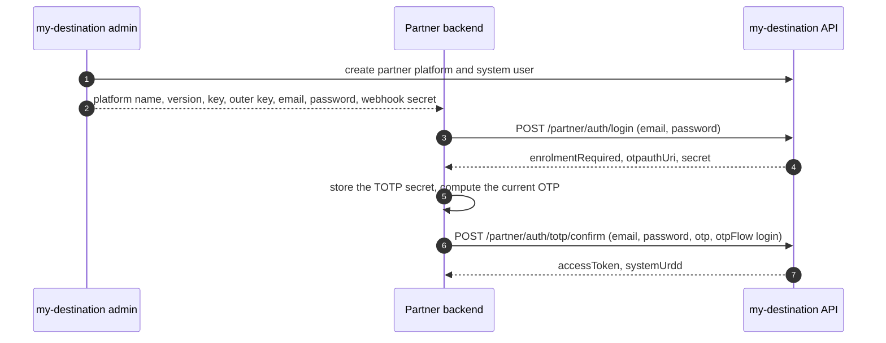
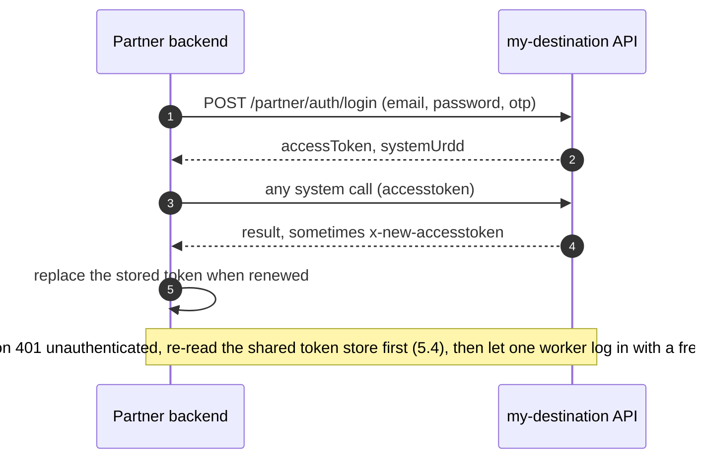
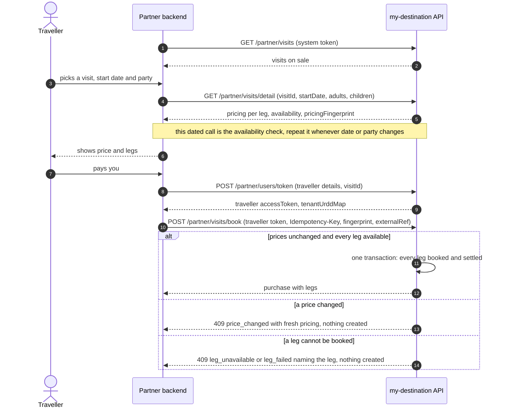
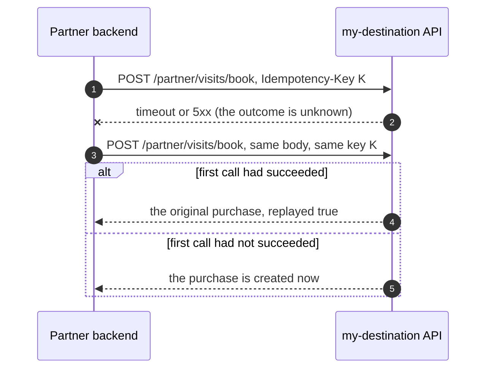
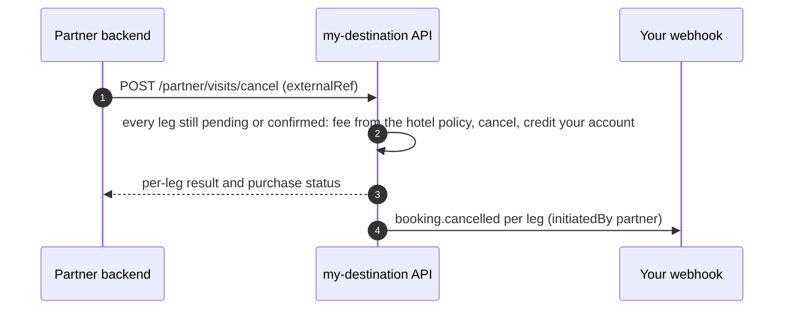
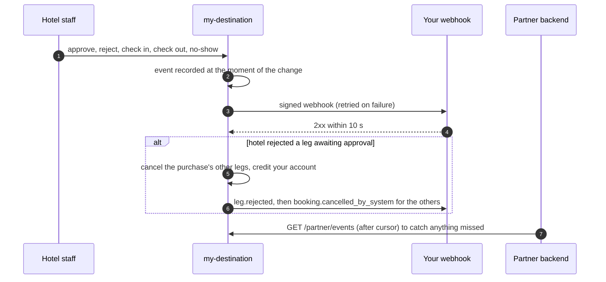

# Partner Integration Guide

This guide is for engineering teams at **partner platforms** (travel apps and websites) that sell my-destination **visits** to their own users. It covers everything a partner backend needs: credentials, the encrypted transport, authentication, every endpoint with its request and response, the errors it can return, and the events my-destination sends back.

A **visit** is a bundle of hotel packages and services from several hotels, sold at one price. When you book a visit, my-destination creates one booking per component (a **leg**) at that component's hotel, all at once: either every leg is created or none is.

| Section | |
|---|---|
| 1. What you receive at onboarding | credentials and settings |
| 2. Transport: the encrypted envelope | how every request and response is encoded |
| 3. Responses and errors | envelope shapes, SCCs, retry guidance, language |
| 4. End-to-end flows | sequence diagrams |
| 5. Authentication APIs | login, TOTP enrolment and rotation, keeping tokens valid (5.4) |
| 6. Catalogue APIs | visit list and priced detail, booking forms, hotel and location objects |
| 7. Traveller API | traveller token |
| 8. Booking APIs | book, cancel, purchases, leg service scheduling |
| 9. Events | webhooks and replay |
| 10. Integration checklist | before going live |

---

## 1. What you receive at onboarding

my-destination creates your platform and hands these over **once, out of band**. Store them in a secret manager.

| Item | Example | Used for |
|---|---|---|
| Base URL | `https://api.<environment>.example/api` | every call; each environment (pre-prod, prod) has its own credentials |
| Platform name | `TravelCo` | `PlatformName` in every envelope |
| Platform version | `1.0.0` | `PlatformVersion` in every envelope |
| Platform key | 32 hex characters | inner encryption layer |
| Outer key | shared string | outer encryption layer |
| System user email + password | `my-destination@travelco.example.com` / random | partner login |
| Webhook secret | `whsec_…` | verifying webhooks (only if you gave a webhook URL) |

Optional settings my-destination records for you: the egress IPs of your servers (calls from other addresses are refused), a rate limit (requests per minute, default 600), your webhook URL, and contacts for incidents and key rotation. Key rotation is done by my-destination adding a new platform version with a new key; you switch `PlatformVersion` and key together.

---

## 2. Transport: the encrypted envelope

Every request is **AES-256-ECB, PKCS#7, base64**, using keys cut or right-padded with `0` to 32 characters, in two layers:

```text
innerKey   = (accessToken on authenticated calls, else "") + platformKey
reqData    = AES(JSON(payload), innerKey)
outer      = { reqData, encryptionDetails: { PlatformName, PlatformVersion, accessToken } }
encryptedRequest = AES(JSON(outer), outerKey)
```

| Method | Where `encryptedRequest` goes |
|---|---|
| `POST`, `PUT` | JSON body `{ "encryptedRequest": "<base64>" }` |
| `GET` | header `encryptedrequest: <base64>` (a GET may still carry a payload in `reqData`) |

> **Where every field goes.** All request fields, including `actionPerformerURDD`, go **inside the encrypted payload** (`reqData`), never as plain body or query fields.
> - **POST:** the encrypted envelope is the request body, `{ "encryptedRequest": "<base64>" }`.
> - **GET:** there is no body, so the encrypted envelope goes in the `encryptedrequest` header. Plain query parameters such as `?page=2` are also read on the list GETs, but they travel unencrypted, so prefer the payload.
> - **Authenticated APIs** (every API after section 5) always need the access token twice: in the `accesstoken` header and in `encryptionDetails.accessToken`. Its value is also the first part of `innerKey`. Section 5 login calls and the image call in 6.3 send **no** access token.

| API | Method | Access token | `actionPerformerURDD` |
|---|---|---|---|
| 5.1 to 5.3 login, TOTP confirm, TOTP rotate | `POST` | none | not sent |
| 5.4 traveller refresh (`/api/auth/refresh`) | `POST` | none (the expired token goes in the payload) | not sent |
| 6.1 list visits, 6.1.1 search and filter, 6.2 visit detail | `GET` | system | `systemUrdd` |
| 6.3 visit images | `GET` | none | not sent |
| 7.1 traveller token | `POST` | system | `systemUrdd` |
| 8.1 book, 8.2 cancel, 8.6 schedule | `POST` | traveller | the traveller's `tenantUrddMap.global` |
| 8.5 service slots | `GET` | traveller | the traveller's `tenantUrddMap.global` |
| 8.3 purchases | `GET` | system or traveller | `systemUrdd`, or the traveller's `tenantUrddMap.global` |
| 9.3 events replay | `GET` | system | `systemUrdd` |

Headers on **every** request:

| Header | Value |
|---|---|
| `Content-Type` | `application/json` |
| `x-client-platform` | `web` |
| `x-client-device-uuid` | a stable UUID for your backend |
| `x-app-version` | your integration version, e.g. `1.0.0` |
| `accesstoken` | the current access token, on authenticated calls |
| `Idempotency-Key` | on `POST /api/partner/visits/book` only |

Responses are encrypted with the **same inner key** you used for the request. A renewed access token may arrive in the `x-new-accesstoken` response header at any time; replace your stored token with it immediately, because the previous one stops working.

Reference client (Node.js, `crypto-js`). It reads your credentials from environment variables named `MY_DESTINATION_*`; the names are only an example, so use whatever your own configuration calls them:

```js
const CryptoJS = require("crypto-js");
const axios = require("axios");

const fit = (k) => (k.length > 32 ? k.slice(0, 32) : k.padEnd(32, "0"));
const aes = (obj, key) => CryptoJS.AES.encrypt(JSON.stringify(obj), CryptoJS.enc.Utf8.parse(fit(key)),
  { mode: CryptoJS.mode.ECB, padding: CryptoJS.pad.Pkcs7 }).toString();
const unaes = (text, key) => JSON.parse(CryptoJS.AES.decrypt(text, CryptoJS.enc.Utf8.parse(fit(key)),
  { mode: CryptoJS.mode.ECB, padding: CryptoJS.pad.Pkcs7 }).toString(CryptoJS.enc.Utf8));

async function my-destination(method, path, body = {}, { token = null, headers = {} } = {}) {
  const inner = `${token || ""}${process.env.MY_DESTINATION_PLATFORM_KEY}`;
  const envelope = {
    reqData: aes(body, inner),
    encryptionDetails: { PlatformName: process.env.MY_DESTINATION_PLATFORM_NAME, PlatformVersion: process.env.MY_DESTINATION_PLATFORM_VERSION, accessToken: token },
  };
  const encryptedRequest = aes(envelope, process.env.MY_DESTINATION_OUTER_KEY);
  const res = await axios({
    method,
    url: process.env.MY_DESTINATION_BASE_URL + path,
    validateStatus: () => true,
    headers: {
      "Content-Type": "application/json",
      "x-client-platform": "web",
      "x-client-device-uuid": process.env.MY_DESTINATION_DEVICE_UUID,
      "x-app-version": "1.0.0",
      ...(token ? { accesstoken: token } : {}),
      ...(method === "GET" ? { encryptedrequest: encryptedRequest } : {}),
      ...headers,
    },
    data: method === "GET" ? undefined : { encryptedRequest },
  });
  const renewed = res.headers["x-new-accesstoken"];
  if (res.status >= 200 && res.status < 300) {
    return { ok: true, status: res.status, renewed, message: res.data.meta?.message, result: unaes(res.data.data, inner).return };
  }
  return { ok: false, status: res.status, scc: res.data?.meta?.scc, message: res.data?.meta?.message, error: res.data?.error };
}
```

---

## 3. Responses and errors

### Success

```json
{ "success": true, "data": "<base64 ciphertext>", "meta": { "message": "Your visit has been booked.", "status": 200, "priority": 1 } }
```

`data` decrypts to `{ "return": <result> }`. Every result shown in this guide is the decrypted `return`, and every path in the **Response fields** tables starts there: `pricing.available` means `return.pricing.available`. A path with `[]` is an array item, so `pricing.legs[].legNet` is the `legNet` of each leg. "Nullable" means the key is always present but its value may be `null`; a field that can be missing says so. `meta.message` is a human sentence in the request's language (`?language_code=ar` for Arabic).

### Error

Errors are **not encrypted**:

```json
{
  "success": false,
  "data": null,
  "meta": {
    "message": "Prices have changed since you priced this visit. Show the new prices and try again.",
    "status": 409,
    "detail": "Prices changed since the detail read; re-display and retry",
    "priority": 4,
    "source": "Visits",
    "scc": "price_changed"
  },
  "error": {
    "message": "Prices changed since the detail read; re-display and retry",
    "detail": "Prices have changed since you priced this visit. Show the new prices and try again.",
    "code": "price_changed",
    "source": "Visits",
    "details": { "code": "price_changed", "pricing": { } }
  }
}
```

| Field | Use it for |
|---|---|
| `meta.scc` (= `error.code`) | **branching** in your code |
| `meta.message` | a sentence you may show to your user |
| `error.details` | structured data for some errors (fresh pricing, the failing leg, `lockedUntil`, …) |
| `meta.detail` | developer text for your logs; do not show it to users |

### Framework errors (any endpoint)

| HTTP | SCC | Meaning | What to do |
|---|---|---|---|
| 400 | `E10` | the envelope could not be decrypted, or a required field is missing | check keys, platform name and version, payload |
| 400 | `E51` | platform not accepted for this endpoint | check `PlatformName` |
| 401 | `unauthenticated` | access token missing, expired, revoked or bound to another platform | log in again (system) or issue a new traveller token |
| 403 | `E31` | the actor lacks the permission for this endpoint | wrong `actionPerformerURDD` for the token |
| 404 | `E50` | unknown endpoint | check the path |
| 405 | `E52` | wrong HTTP method | check the method |
| 429 | `rate_limited` | over your per-minute limit | back off and retry after a minute |
| 500 | `E99`, `E22` | server fault | retry with backoff; book calls are safe to retry with the same `Idempotency-Key` |

### Partner errors on every partner endpoint

| HTTP | SCC | Meaning |
|---|---|---|
| 403 | `not_a_partner_platform` | the platform in the envelope is not an active partner |
| 403 | `ip_not_allowed` | the call came from an address outside your registered egress IPs |
| 403 | `origin_not_allowed` | a browser call whose `Origin` is not on your registered domains. Server-to-server calls send no `Origin` and are not affected |
| 403 | `wrong_token` | a system token was used where a traveller token is needed, or the reverse, or the token belongs to another platform |
| 403 | `persona_mismatch` | `actionPerformerURDD` does not belong to the token's user, or is not the right kind of seat |
| 409 | `concurrent_request` | another request for the same purchase is in progress; retry shortly |

### Language

Every partner visit API returns its text in **one language**: the one you ask for with `language_code`, or English when you send none.

```
GET /api/partner/visits/detail?language_code=ar
```

You can also send `language_code` in the encrypted body. The query string wins when both are sent. Wherever you send it, the same value sets the language of the data **and** of `meta.message`. The code is case-insensitive (`AR` = `ar`).

| Rule | Behaviour |
|---|---|
| Default | `en` |
| Supported codes | the languages my-destination has active, currently `en`, `ar`, `ur` and `fr` |
| Unsupported or unknown code | treated as `en`; no error |
| A text with no translation in that language | that one field comes back in English; the rest of the response stays in the requested language |
| `meta.message` | translated for every partner endpoint, on success and for every error code, in Arabic. Urdu and French messages are not translated yet and come back in English |
| Errors | the HTTP status, `error.details.code` and `meta.scc` are the same in every language. `error.message` and `meta.detail` are English developer text. Data inside `error.details` (for example the fresh `pricing` of a `409 price_changed`) is localized like a success result |
| Shape | every text field is a **single string**. No response contains `{ "en": …, "ar": … }` pairs |

**Translated:**
- the visit's `name`, `description` and text `configs` (for example `display_name`);
- leg and component names (`legs[].name`, `pricing.legs[].name`);
- hotel names (`hotelName`, `hotel.name`) and the hotel location chain (country, state, city, address);
- the names in each in-hotel `locations[]` path;
- service names and labels;
- `formSchema` options and location names. The form field labels themselves (`formSchema[].label`) are English for now; render your own label from `formSchema[].key` when you need it in another language;
- the booking labels inside `legs[].booking`;
- the service labels and location names in the slots call (`category` itself is a code and does not change).

**Never translated:** ids, codes, slugs and enum values, for example:
- `status`, `type`, `category`, `rule`, the `formSchema[].key` and option `value`;
- currency codes, dates, emails and coordinates.

Branch your code only on these, never on a display text. `violations[].message` is an English developer sentence; show `meta.message` to users.

**When to call again.** my-destination doesn't push a language change to you: webhooks carry ids and statuses, no display text. Whenever your user's language changes, fetch again whatever you show:

| Your user… | Call again, with the new `language_code` |
|---|---|
| switches language on a catalogue screen | `GET /api/partner/visits` (or `GET /api/partner/visits/filter`) and, for an open visit, `GET /api/partner/visits/detail` |
| switches language on a booking or trip screen | `GET /api/partner/visits/bookings` (or filter by `externalRef`) |
| switches language while scheduling a service | `GET /api/partner/visits/legs/slots` |
| books, cancels or schedules | send their current `language_code` on the call itself: the response's purchase or leg comes back in that language |
| gets a webhook (any event type) | fetch the purchase with `GET /api/partner/visits/bookings` in the user's language, then render it |

#### Language support by endpoint

"Data" is what the decrypted `return` holds; "Message" is `meta.message`. Every endpoint accepts `language_code` the same way (query string or encrypted body).

| Endpoint | Data in the requested language | Message | Worth knowing |
|---|---|---|---|
| `POST /api/partner/auth/login` | none: `otpauthUri` and tokens only | yes | |
| `POST /api/partner/auth/totp/confirm` | none: tokens, `rotated` | yes | |
| `POST /api/partner/auth/totp/rotate` | none: `otpauthUri` | yes | |
| `POST /api/auth/refresh` | none: tokens, `tenantUrddMap` | yes | |
| `GET /api/partner/visits` | `name`, `description`, text `configs` (`display_name`…), `legs[].name`, `legs[].hotelName`, `legs[].hotel.name` and the hotel's location chain | yes | the `etag` differs per language |
| `GET /api/partner/visits/filter` | everything in the row above, plus `facets.cities[].name` | yes | `q` matches English and every translation, whatever `language_code` is. `appliedFilters.q` echoes your text as sent. Facet ids and counts are the same in every language |
| `GET /api/partner/visits/detail` | the list fields, plus `legs[].services[].name`, the `locations[]` path names, `formSchema` options and `pricing.legs[].name`. `formSchema[].label` stays English | yes | the `etag` differs per language, so an `ifNoneMatch` from another language gets the full detail. Prices and `pricingFingerprint` are identical: a price checked in one language books in any other |
| `GET /api/upload/serve` | not applicable: the image itself | | |
| `POST /api/partner/users/token` | none: tokens, ids, `tenantUrddMap` | yes | |
| `POST /api/partner/visits/book` | the purchase: `visitName`, leg, hotel, location and service names, booking labels. Also the fresh `pricing` in a `409 price_changed` | yes | a retry with the same `Idempotency-Key` returns the same purchase in the retry's language |
| `POST /api/partner/visits/cancel` | the cancelled purchase, as in `book` | yes | |
| `GET /api/partner/visits/bookings` | `items[].visitName`, `legs[].booking.label`, `legs[].booking.services[].label`, `legs[].hotel.name` and its location chain, `legs[].services[].name` | yes | |
| `GET /api/partner/visits/legs/slots` | `categories[].locations[].services[].label`, location names, `formSchema` options | yes | `category`, dates, slot times and `slotId`s never change |
| `POST /api/partner/visits/legs/schedule` | the returned `booking`, as in `bookings` | yes | |
| `GET /api/partner/events` | none: ids, codes and statuses only; identical in every language | yes | |
| Webhooks (9.2) | none: no display text, and no language. Fetch `bookings` in your user's language to render an event | | |

In every row, switching the language changes **only** display text. Ids, prices, quantities, dates, statuses and other codes are byte-for-byte the same.

**Caching:**
- Key cached catalogue and purchase data by language as well as by id: (`visitId`, `language_code`), (`externalRef`, `language_code`).
- The visit `etag` already depends on the language, so an `ifNoneMatch` from another language always gets the full detail back, never `notModified`.
- What is stored (ids, dates, prices, the fingerprint and the booking itself) is the same in every language. A language switch never needs a new booking or a new price check. Re-pricing is only needed when dates or the party change.

---

## 4. End-to-end flows

### 4.1 Onboarding and first login



### 4.2 Daily session



### 4.3 Browse, price and book



### 4.4 Safe retry



### 4.5 Cancellation



### 4.6 Hotel-side changes



Hotel staff can only move a visit leg through its statuses: approve or reject a pending leg, check in, check out, mark a no-show. They cannot change a leg's dates, party, price or services, and cannot cancel a confirmed leg.

### 4.7 After booking

A booked visit cannot be changed: there is no edit, extension, reschedule or add-on for a leg, from your platform or from the hotel. To change a trip, cancel the whole visit (4.5) and book again. Every leg is paid in full when the visit is booked, so a leg never has a balance due.

---

## 5. Authentication APIs

The partner backend signs in as its **system user**. There is no refresh token: when the access token expires, log in again. TOTP is RFC 6238 (SHA-1, 6 digits, 30-second period, ±1 step); compute it from the stored secret with any standard TOTP library. Each OTP is accepted **once**: a second call in the same 30-second step needs the next code.

These three endpoints use the envelope **without** an access token: no `accesstoken` header, `encryptionDetails.accessToken` is `null`, and `innerKey = platformKey`. Don't send `actionPerformerURDD` either, since you don't have one until login returns `systemUrdd`. The encrypted payload is the POST body `{ "encryptedRequest": "<base64>" }`.

### 5.1 Login — `POST /api/partner/auth/login`

**Request**

| | |
|---|---|
| Method | `POST /api/partner/auth/login` |
| Access token | none, so send no `accesstoken` header and use `innerKey = platformKey` |
| `actionPerformerURDD` | not sent |
| Encrypted payload goes in | the JSON body `{ "encryptedRequest": "<base64>" }` |
| Language | messages only: `meta.message` follows `language_code`; the result (`otpauthUri`, tokens) has no display text ([by endpoint](#language-support-by-endpoint)) |

Payload (the JSON inside `reqData`, before encryption):

```json
{ "email": "my-destination@travelco.example.com", "password": "S3cr3t…", "otp": "117604" }
```

| Field | Type | Required | Notes |
|---|---|---|---|
| `email` | string | yes | system user email |
| `password` | string | yes | |
| `otp` | string | after enrolment | 6 digits |

Before enrolment, call without `otp`:

```json
{ "email": "my-destination@travelco.example.com", "password": "S3cr3t…" }
```

```json
{ "enrolmentRequired": true,
  "otpauthUri": "otpauth://totp/my-destination:my-destination%40travelco.example.com%20(TravelCo)?secret=JBSWY3DPEHPK3PXP&issuer=my-destination&algorithm=SHA1&digits=6&period=30",
  "secret": "JBSWY3DPEHPK3PXP" }
```

Calling again before confirming replaces the pending secret. After enrolment:

```json
{ "email": "my-destination@travelco.example.com", "password": "S3cr3t…", "otp": "117604" }
```

```json
{ "accessToken": "eyJhbGciOi…", "expiresIn": 3600, "tokenType": "partner_system",
  "systemUrdd": 4410, "platform": { "id": 8, "name": "TravelCo" } }
```

Send `systemUrdd` as `actionPerformerURDD` on every system call.

**Response fields.** The result has one of two shapes. Before enrolment (no `otp` sent and no active TOTP):

| Path | Type | Nullable | Values and notes |
|---|---|---|---|
| `enrolmentRequired` | boolean | no | always `true` in this shape |
| `otpauthUri` | string | no | `otpauth://totp/<issuer>:<email> (<platform>)?secret=…&issuer=…&algorithm=SHA1&digits=6&period=30`; load it into an authenticator or TOTP library |
| `secret` | string | no | the same secret in base32, 32 characters |

After enrolment, with a valid `otp`:

| Path | Type | Nullable | Values and notes |
|---|---|---|---|
| `accessToken` | string | no | the system token (JWT) |
| `expiresIn` | number | no | lifetime in seconds: **1 hour (3600)** in production. Test environments may use a different lifetime. Read this field instead of hard-coding it |
| `tokenType` | string | no | always `partner_system` |
| `systemUrdd` | number | no | send as `actionPerformerURDD` on every system call |
| `platform.id` | number | no | your platform id |
| `platform.name` | string | no | your platform name |

| HTTP | SCC | When |
|---|---|---|
| 400 | `credentials_required` | email or password missing |
| 400 | `otp_required` | enrolled but no `otp` |
| 401 | `invalid_credentials` | wrong email or password |
| 401 | `invalid_otp` | wrong OTP, or already used |
| 403 | `totp_revoked` | my-destination revoked your TOTP; contact my-destination |
| 409 | `totp_confirm_required` | `otp` sent while enrolment is still pending |
| 423 | `locked` | five failures in a row; `error.details.lockedUntil` (15 minutes) |

### 5.2 Confirm a pending secret — `POST /api/partner/auth/totp/confirm`

**Request**

| | |
|---|---|
| Method | `POST /api/partner/auth/totp/confirm` |
| Access token | none, so send no `accesstoken` header and use `innerKey = platformKey` |
| `actionPerformerURDD` | not sent |
| Encrypted payload goes in | the JSON body `{ "encryptedRequest": "<base64>" }` |
| Language | messages only: `meta.message` follows `language_code`; the result has no display text |

Payload (the JSON inside `reqData`, before encryption):

```json
{ "email": "my-destination@travelco.example.com", "password": "S3cr3t…", "otp": "492039", "otpFlow": "login" }
```

| Field | Type | Required | Notes |
|---|---|---|---|
| `email`, `password` | string | yes | |
| `otp` | string | yes | from the **pending** (new) secret |
| `otpFlow` | `login` \| `rotation` | yes | `login` finishes enrolment, `rotation` finishes a rotation |

`otpFlow: login` returns the login response plus `"enrolled": true`. `otpFlow: rotation` returns `{ "rotated": true }` and no token; your session carries on.

**Response fields**

| Path | Type | Nullable | Values and notes |
|---|---|---|---|
| `enrolled` | boolean | no | `otpFlow: login` only, always `true` |
| `accessToken`, `expiresIn`, `tokenType`, `systemUrdd`, `platform.id`, `platform.name` | | no | `otpFlow: login` only, as in the login session response (5.1) |
| `rotated` | boolean | no | `otpFlow: rotation` only, always `true`; no token fields are returned |

| HTTP | SCC | When |
|---|---|---|
| 400 | `invalid_otp_flow` | `otpFlow` is neither `login` nor `rotation` |
| 401 | `invalid_otp` | wrong OTP for the pending secret |
| 409 | `otp_flow_mismatch` | no enrolment (for `login`) or no rotation (for `rotation`) is pending |
| | | plus `credentials_required`, `invalid_credentials`, `locked`, `totp_revoked` as for login |

### 5.3 Start a rotation — `POST /api/partner/auth/totp/rotate`

**Request**

| | |
|---|---|
| Method | `POST /api/partner/auth/totp/rotate` |
| Access token | none, so send no `accesstoken` header and use `innerKey = platformKey` |
| `actionPerformerURDD` | not sent |
| Encrypted payload goes in | the JSON body `{ "encryptedRequest": "<base64>" }` |
| Language | messages only: `meta.message` follows `language_code`; the result has no display text |

Payload (the JSON inside `reqData`, before encryption):

```json
{ "email": "my-destination@travelco.example.com", "password": "S3cr3t…", "otp": "117604" }
```

`{ email, password, otp }`, with `otp` from the **current** secret. Returns `{ "rotationPending": true, "otpauthUri": "…", "secret": "…" }`. The old secret keeps working until you confirm with `otpFlow: rotation`.

**Response fields**

| Path | Type | Nullable | Values and notes |
|---|---|---|---|
| `rotationPending` | boolean | no | always `true` |
| `otpauthUri` | string | no | the **new** secret's URI, same format as in 5.1 |
| `secret` | string | no | the new secret in base32 |

| HTTP | SCC | When |
|---|---|---|
| 409 | `totp_not_active` | not enrolled yet |
| 401 | `invalid_otp` | wrong OTP from the current secret |
| | | plus `credentials_required`, `invalid_credentials`, `locked`, `totp_revoked` |

---

### 5.4 Keeping tokens valid

Both kinds of token are bound to your platform and only work on `/api/partner/*` (and `/api/auth/refresh` for travellers). my-destination keeps **one stored token per session**, and a request must carry exactly that token. The moment a token is replaced, the previous one stops working: there is no overlap.

| Situation | What my-destination does | What you do |
|---|---|---|
| The token is in its last 20% of life | the response (success or error) carries a new token in `x-new-accesstoken`; the old one is dead from that moment | replace the stored token at once, before the next call. Calls made in the same second get the same new token |
| A call is still using a token that was just replaced (another worker, a queued call, a retry) | `401 unauthenticated` | re-read the token from your shared store and retry. Do **not** log in again first |
| The system token expired | `401 unauthenticated` | log in again (5.1) with a fresh OTP. System sessions have no refresh token; `POST /api/auth/refresh` with a system token is `401 refresh_not_allowed` |
| You log the system user in again | the new session replaces the previous one: the earlier token is `401` from then on | there is **one system session per system user per platform version**. Run one login for all your servers, not one per server |
| The traveller token expired | | call `POST /api/auth/refresh` with the expired `accesstoken` and the `refreshToken` (7.1). The new pair stays bound to your platform. Each refresh token works **once**: a reused one is `409 refresh_replayed` |
| The traveller token expired more than the grace period ago (20% of the token lifetime), or the refresh token itself expired | refresh is refused: `401 access_expired_beyond_grace`, or `410 refresh_expired` | mint a new traveller token with the system token: `POST /api/partner/users/token` with the traveller's email (7.1). Same user, same `tenantUrddMap.global` |
| You mint a new traveller token | the traveller's previous token is revoked | keep only the latest token per traveller |

**With several servers or workers:**

1. Keep **one shared token store** (for example Redis or your database) for the system token and for each traveller's token pair. Every worker reads from it before a call and writes to it whenever a response carries `x-new-accesstoken`.
2. On `401 unauthenticated`, first re-read the store: if another worker already saved a newer token, retry with it.
3. Only if the stored token is the one that failed, take a lock and let **one** worker log in (or refresh, for a traveller). The others wait for the store to update. Parallel logins replace each other's sessions, and each OTP is accepted only once.

## 6. Catalogue APIs

System token; `actionPerformerURDD` = `systemUrdd`.

### 6.1 List visits — `GET /api/partner/visits`

**Request**

| | |
|---|---|
| Method | `GET /api/partner/visits` |
| Access token | **required**, the **system** token in the `accesstoken` header (and in `encryptionDetails.accessToken`) |
| `actionPerformerURDD` | `systemUrdd` |
| Encrypted payload goes in | the `encryptedrequest` header |
| Language | **data and messages**: names, descriptions, text `configs`, leg, hotel and location names come back in `language_code`; the `etag` is per language ([by endpoint](#language-support-by-endpoint)) |

Payload (the JSON inside `reqData`, before encryption):

```json
{ "actionPerformerURDD": 4410, "page": 1, "pageSize": 20 }
```


Fields: `page` (alias `page_no`), `pageSize` (max 100, alias `page_size`). Only visits currently on sale are returned (published, every hotel active and participating, priced).

**No paging unless you ask for it.** Without `page` and `pageSize`, every visit on sale is returned in one response, and `pagination.page` and `pagination.pageSize` are `null`. Send either one to page: a missing `page` is `1` and a missing `pageSize` is `20`.

```json
{ "items": [
    { "dto": "PartnerVisitV1", "id": 42, "visitCode": "MKK-MDN-5N", "name": "Makkah and Madinah, 5 nights",
      "description": "…", "availableFrom": "2026-11-01", "availableTo": "2027-03-31", "durationDays": 5,
      "price": { "amount": 6000, "listAmount": 6000, "currency": "SAR" },
      "legs": [
        { "legNo": 1, "type": "package", "recordId": 367, "name": "Generosity Umrah Package", "hotelId": 86,
          "hotelName": "Le Meridien Makkah", "category": null, "dayOffset": 0, "nights": 3, "quantity": 1 },
        { "legNo": 2, "type": "package", "recordId": 422, "name": "Romance Escape", "hotelId": 106,
          "hotelName": "Sample Grand Hotel II", "category": null, "dayOffset": 3, "nights": 2, "quantity": 1 } ],
      "configs": { "display_name": "Makkah and Madinah", "is_featured": "true",
                   "base_currency": "SAR", "media": ["201", "202"] }, "updatedAt": "2026-10-04T10:07:00Z", "etag": "W/\"7b0c19f2a1\"" } ],
  "pagination": { "page": 1, "pageSize": 20, "totalItems": 1, "totalPages": 1 } }
```

`availableFrom` / `availableTo` bound the trip: any start date works as long as the whole trip, from `startDate` to `startDate` + `durationDays` nights, falls inside them. Either may be `null` (open-ended). `durationDays` is the visit's length in nights. `dayOffset` is the day of the visit a leg starts on.

`quantity` on a package leg is how many packages each purchase books (parallel rooms). The party is split across them, and a party too large for that many packages books more. `componentPrice` already includes every package booked.


**Response fields.** `items[]` is a list of visit objects. The same visit object is the result of 6.2, so these paths apply there too without the `items[].` prefix.

| Path | Type | Nullable | Values and notes |
|---|---|---|---|
| `items[].dto` | string | no | always `PartnerVisitV1`; changes only with a new contract version |
| `items[].id` | number | no | the `visitId` for 6.2 and 8.1 |
| `items[].visitCode` | string | no | `VIS-` and 6 letters or digits, e.g. `VIS-441DPG` |
| `items[].name` | string | no | |
| `items[].description` | string | yes | |
| `items[].availableFrom` | `YYYY-MM-DD` | yes | first day a trip may start; `null`: no lower bound |
| `items[].availableTo` | `YYYY-MM-DD` | yes | last day a trip may end; `null`: open-ended |
| `items[].durationDays` | number | yes | trip length in nights |
| `items[].price` | object | yes | the visit's sell price; `null` only when the visit has no active price (it is then not listed in 6.1) |
| `items[].price.amount` | number | no | current sell price, after any active discount |
| `items[].price.listAmount` | number | no | list price before discount; equal to `amount` when there is none |
| `items[].price.currency` | string | no | ISO currency code, e.g. `SAR` |
| `items[].legs[]` | array | no | the itinerary in order, at least one leg |
| `items[].legs[].legNo` | number | no | 1, 2, 3, … in itinerary order |
| `items[].legs[].type` | string | no | `package` or `stay` (a room type). Visits created before 2026-10-08 may still have `service` legs until they are next edited |
| `items[].legs[].recordId` | number | no | the package id or service id at the hotel |
| `items[].legs[].name` | string | no | the package or service name |
| `items[].legs[].hotelId` | number | no | |
| `items[].legs[].hotelName` | string | no | |
| `items[].legs[].hotel` | object | yes | the leg's hotel and its location hierarchy, see [6.5](#65-hotel-and-location-objects) |
| `items[].legs[].category` | string | yes | stay legs: `stay` (older `service` legs: their category slug). Always `null` on package legs |
| `items[].legs[].dayOffset` | number | no | day of the trip the leg starts on, `0` = `startDate`. Legs are back to back: each starts the day the previous one ends |
| `items[].legs[].nights` | number | no | package legs: the package's nights plus any extra nights. Stay legs: the stay length |
| `items[].legs[].quantity` | number | no | the least units booked per purchase: packages for a package leg, rooms for a stay leg. A larger party books more (see `pricing.legs[].units`) |
| `items[].configs` | object | no | the visit's display settings by config key; `{}` when none (see below) |
| `items[].updatedAt` | ISO 8601 datetime | no | last change to the visit |
| `items[].etag` | string | no | e.g. `W/"edfe4b465a207d255849"`; changes when the visit, its legs, price or configs change |
| `pagination.page` | number | yes | `null` when no `page` or `pageSize` was sent (every match returned) |
| `pagination.pageSize` | number | yes | `null` when no `page` or `pageSize` was sent |
| `pagination.totalItems` | number | no | visits on sale |
| `pagination.totalPages` | number | no | `0` when there are none; `1` when unpaged |

`configs` has one key per config the visit has; keys that are not set are absent, and my-destination may add keys over time, so ignore ones you don't use. Each value follows these rules:

| Config | Value |
|---|---|
| a translatable text value | a string in the requested language ([Language](#language)), e.g. `display_name` = `"Makkah and Madinah"`, or `"مكة والمدينة"` with `language_code=ar` |
| a text or number value without a translation | a string, e.g. `"3"`, `"2026-10-31 00:00:00"`; JSON text is returned parsed |
| an option (chosen from a list) | the option's value, e.g. `duration_unit` = `{ "value": "Nights", "key": "nights" }` |
| `base_currency` | a currency code string, e.g. `"SAR"` |
| a multi-value key (e.g. `media`, `allowed_regions`) | an array of the values above, e.g. `media` = `["1520", "1521"]` (attachment ids for 6.3) |

Keys you will commonly see: `display_name`, `media`, `is_featured`, `base_price`, `base_currency`, `duration`, `duration_unit`, `publish_start_datetime`, `publish_end_datetime`, `advance_booking_min_days`, `advance_booking_max_days`, `min_persons_per_booking`, `max_persons_per_booking`, `max_adults`, `max_children`, `allowed_regions` (an array with one object mapping a region id to its city ids).


### 6.1.1 Search and filter visits — `GET /api/partner/visits/filter`

The same visits as 6.1 (only visits on sale), narrowed by filters, sorted and paged. Use it for search screens; use 6.1 when you only need the full catalogue.

**Request**

| | |
|---|---|
| Method | `GET /api/partner/visits/filter` |
| Access token | **required**, the **system** token |
| `actionPerformerURDD` | `systemUrdd` |
| Permission | `partner_list_visits` (the same as 6.1) |
| Encrypted payload goes in | the `encryptedrequest` header |
| Language | **data and messages**: as 6.1, plus `facets.cities[].name`. `q` matches every language whatever `language_code` says ([Search and filter languages](#search-and-filter-languages)) |

```json
{
  "actionPerformerURDD": 4410,
  "cityId": "1,2",
  "cityMatch": "all",
  "minPrice": 3000,
  "maxPrice": 9000,
  "stayDuration": "4-7",
  "startDate": "2026-11-20",
  "adults": 2,
  "children": 1,
  "filters": "[{\"key\":\"is_featured\",\"value\":\"true\"}]",
  "sort": "priceAsc",
  "page": 1,
  "pageSize": 20
}
```

Every field is optional. Filters combine with AND. With no filter at all the result is the same list as 6.1, plus `facets` and `appliedFilters`.

The fields can also be sent in the query string (`/api/partner/visits/filter?cityId=1&sort=priceAsc`). When a field is in both, the encrypted payload wins.

| Field | Type | Meaning |
|---|---|---|
| `q` | string, at most 100 characters, **any language** | case-insensitive text match on the visit name and description, `visitCode`, `display_name`, `short_description`, the legs' package, room and hotel names, and the hotels' city names, **in English and in every stored translation**. See [Search and filter languages](#search-and-filter-languages) |
| `cityId` | one id or a comma-separated list | visits with a leg at a hotel in one of these cities. City ids come from `facets.cities` in this response: see [Getting the city ids](#getting-the-city-ids) |
| `cityMatch` | `any` (default) or `all` | `all`: the visit must have a leg in **every** listed city, e.g. `cityId=1,2&cityMatch=all` for trips that cover both Makkah and Madinah |
| `hotelId` | one id or a comma-separated list | visits with a leg at one of these hotels |
| `minPrice`, `maxPrice` | number, 0 or more | on `price.amount`, the visit's sell price for a party that fits the base units (6.2 explains how a bigger party's price scales) |
| `minNights`, `maxNights` | whole number, 0 or more | on `durationDays` |
| `stayDuration` | `4-7`, `8+` or `5` | a nights range, used only when `minNights` and `maxNights` are not sent |
| `startDate` | `YYYY-MM-DD`, today or later | visits whose window holds a trip starting that day: `availableFrom` ≤ `startDate` and `startDate` + `durationDays` ≤ `availableTo`. Free rooms and notice rules are checked by 6.2 |
| `adults`, `children` | `adults` at least 1, `children` 0 or more | visits where **every** leg can take the party in one purchase: enough adult and child places, rooms the hotel has, per-booking caps and minimums. The same rule as the units in 6.2. `children` alone is refused |
| `filters` | JSON array of `{ "key", "value" }` | the visit's `configs` must hold the value, e.g. `[{"key":"is_featured","value":"true"}]`. `value` may be an array (any of them). Matching is case-insensitive, and `true`/`1`/`yes` are the same. For an option, send its **key** (`nights`), never its translated label. See [Search and filter languages](#search-and-filter-languages) |
| `sort` | `recommended` (default), `priceAsc`, `priceDesc`, `newest`, `durationAsc`, `durationDesc` | `recommended`: featured visits first, then by id. Ties are broken by id |
| `page`, `pageSize` | number | as in 6.1: **without both, every match is returned unpaged** (`pagination.page` and `pageSize` are `null`). Send either one to page (defaults 1 and 20), `pageSize` at most 100 |

**Examples, one filter at a time,** against two sample published visits: `80` (`VIS-441DPG`, "Visit I", 999 SAR, 2 nights, 2026-10-06 to 2026-10-31, featured, one hotel in Makkah) and `526` (`VIS-C050A1`, "Family Umrah Package", 4,470 SAR, 14 nights, from 2026-10-11 with no end, featured, two hotels in Makkah). Each payload also carries `actionPerformerURDD`.

| Payload | `appliedFilters` (changed keys) | Result |
|---|---|---|
| `{ "q": "umrah" }` | `"q": "umrah"` | both: `526` by its name, `80` because a leg's package name contains "Umrah" |
| `{ "cityId": "1" }` | `"cityId": [1], "cityMatch": "any"` | both (Makkah) |
| `{ "cityId": "1,2", "cityMatch": "all" }` | `"cityId": [1, 2], "cityMatch": "all"` | none: no visit has legs in both Makkah and Madinah |
| `{ "hotelId": "88" }` | `"hotelId": [88]` | `526` (its first legs are at hotel 88) |
| `{ "minPrice": 1000, "maxPrice": 5000 }` | `"minPrice": 1000, "maxPrice": 5000` | `526` (4,470) |
| `{ "minNights": 2, "maxNights": 3 }` | `"minNights": 2, "maxNights": 3` | `80` (2 nights) |
| `{ "stayDuration": "8+" }` | `"minNights": 8, "maxNights": null` | `526` (14 nights) |
| `{ "startDate": "2026-10-20" }` | `"startDate": "2026-10-20"` | both: `80` ends 2026-10-22, inside its window. `526` has no end |
| `{ "adults": 2, "children": 1 }` | `"adults": 2, "children": 1` | both: every leg can take the party |
| `{ "adults": 20 }` | `"adults": 20, "children": 0` | none: a leg would need more units than its per-booking cap or the hotel's rooms |
| `{ "filters": "[{\"key\":\"is_featured\",\"value\":\"true\"}]" }` | `"filters": [{ "key": "is_featured", "value": "true" }]` | both (stored as `1`, which matches `true`) |
| `{ "filters": "[{\"key\":\"max_persons_per_booking\",\"value\":[\"2\",\"4\"]}]" }` | `"filters": [{ "key": "max_persons_per_booking", "value": ["2", "4"] }]` | `526` (its value is `2`, one of the list) |
| `{ "sort": "priceDesc" }` | `"sort": "priceDesc"` | `526` (4,470) then `80` (999) |

**Full example.** Every filter together:

```json
{
  "actionPerformerURDD": 4410,
  "q": "umrah",
  "cityId": "1",
  "minPrice": 1000,
  "maxPrice": 9000,
  "stayDuration": "8+",
  "startDate": "2026-10-20",
  "adults": 2,
  "children": 0,
  "filters": "[{\"key\":\"is_featured\",\"value\":\"true\"}]",
  "sort": "priceAsc",
  "page": 1,
  "pageSize": 20
}
```

`cityMatch` and `hotelId` are left out here. `filters` is a JSON **string** inside the payload, so its quotes are escaped. An array (`"filters": [{ "key": "is_featured", "value": "true" }]`) is accepted too.

#### Search and filter languages

| Part | Language rule |
|---|---|
| `q` | any language. It searches the English text **and** every stored translation, whatever `language_code` you send, so an Arabic search box works: `q=العمرة` finds "باقة العمرة العائلية" |
| `cityId`, `hotelId`, prices, nights, `startDate`, `adults`, `children`, `sort` | ids, numbers, dates and fixed values: the same in every language |
| `filters` | keys and stored values, never display labels. Send the option key (`nights`) or the stored value (`true`), not "Nights" or "ليالي". Labels are display text and can change, keys do not |
| The response (names, `facets.cities[].name`) | in the requested `language_code` ([Language](#language)), whatever language `q` was written in |

**How Arabic text is compared.** Both your text and HMS's text are normalised first, so spelling variants match:

| Variant | Treated as |
|---|---|
| `أ` `إ` `آ` `ٱ` | `ا` (`أبراج` = `ابراج`) |
| `ة` | `ه` (`مكة` = `مكه`) |
| `ى` | `ي` (`مستشفى` = `مستشفي`) |
| diacritics (fatha, damma, kasra, shadda, sukun, tanween) and tatweel `ـ` | removed (`مَكَّةُ` = `مكة`) |
| upper and lower case, repeated spaces | ignored |

The match is a substring match, without stemming: `عمرة` and `العمرة` match "باقة العمرة العائلية", but `عائلة` does not match `العائلية` (a different word form). A visit or name without a stored translation is found only by its English text.

#### Getting the city ids

:::tip Where city ids come from
There is no separate cities endpoint. Every filter response lists the cities you can filter on, with their ids, in `facets.cities`. Call the filter once with no filters to build your city picker:

```
GET /api/partner/visits/filter?pageSize=1
```

```json
"facets": { "cities": [ { "cityId": 1, "name": "Makkah", "visitCount": 9 } ] }
```

- **Only useful cities.** The list holds every city that has at least one visit on sale, so you never offer a city that returns nothing. A list of every city in HMS would include hundreds with no visits.
- **Translated names.** `name` comes in the request's language: `language_code=ar` gives "مكة".
- **Stays complete while filtering.** The counts ignore the city filter itself, so when the user picks Makkah, the other cities stay in the picker.
- **Typical flow.** Load the facets once, cache them for a while, and send the chosen city as `cityId`. Send the id, not the name: names vary in spelling ("Makkah", "Mecca") and language, and the id does not.
:::

**How a hotel's city is found.** A hotel belongs to the city set on it in my-destination. When none is set, my-destination matches the city name in the hotel's address to a reference city, preferring one in the hotel's country. A hotel whose address city has no reference city has no city: it never matches `cityId`, and it is left out of `facets.cities`.

**Response**

The shape, shortened:

```json
{
  "items": [ { "dto": "PartnerVisitV1", "id": 42, "visitCode": "VIS-441DPG", "name": "Makkah and Madinah, 5 nights", "...": "the same visit object as 6.1" } ],
  "pagination": { "page": 1, "pageSize": 20, "totalItems": 1, "totalPages": 1 },
  "facets": { "cities": [ { "cityId": 1, "name": "Makkah", "visitCount": 6 }, { "cityId": 2, "name": "Madinah", "visitCount": 2 } ] },
  "appliedFilters": {
    "q": null, "cityId": [1, 2], "cityMatch": "all", "hotelId": null, "minPrice": 3000, "maxPrice": 9000,
    "minNights": 4, "maxNights": 7, "startDate": "2026-11-20", "adults": 2, "children": 1,
    "filters": [ { "key": "is_featured", "value": "true" } ], "sort": "priceAsc"
  }
}
```

<details>
<summary>The full response to the full example above, unshortened (sample data, 2026-10-12)</summary>

```json
{
  "items": [
    {
      "dto": "PartnerVisitV1",
      "id": 526,
      "visitCode": "VIS-C050A1",
      "name": "Family Umrah Package",
      "description": "Get family umrah package",
      "availableFrom": "2026-10-11",
      "availableTo": null,
      "durationDays": 14,
      "price": {"amount": 4470, "listAmount": 4470, "currency": "SAR"},
      "legs": [
        {
          "legNo": 1,
          "type": "package",
          "recordId": 385,
          "name": "Test Pkg",
          "hotelId": 88,
          "hotelName": "Le Meridien Towers",
          "category": null,
          "dayOffset": 0,
          "nights": 2,
          "quantity": 3,
          "hotel": {
            "id": 88,
            "name": "Le Meridien Towers",
            "slug": "le-meridien",
            "logo": null,
            "timezone": "UTC",
            "contact": {"email": "admin@le-meridien.test", "phone": null},
            "location": {
              "id": null,
              "name": "Saudi Arabia",
              "type": "country",
              "child": {
                "id": null,
                "name": "Makkah",
                "type": "city",
                "child": {"id": null, "name": "King Abdulaziz Road, Ajyad District, Makkah 24231", "type": "address"}
              }
            },
            "postalCode": null,
            "coordinates": {"lat": 21.42025, "lng": 39.82918}
          }
        },
        {
          "legNo": 2,
          "type": "stay",
          "recordId": 461,
          "name": "Diplomatic Room (Blind & Deaf + Handicapped)",
          "hotelId": 88,
          "hotelName": "Le Meridien Towers",
          "category": "stay",
          "dayOffset": 2,
          "nights": 8,
          "quantity": 1,
          "hotel": {
            "id": 88,
            "name": "Le Meridien Towers",
            "slug": "le-meridien",
            "logo": null,
            "timezone": "UTC",
            "contact": {"email": "admin@le-meridien.test", "phone": null},
            "location": {
              "id": null,
              "name": "Saudi Arabia",
              "type": "country",
              "child": {
                "id": null,
                "name": "Makkah",
                "type": "city",
                "child": {"id": null, "name": "King Abdulaziz Road, Ajyad District, Makkah 24231", "type": "address"}
              }
            },
            "postalCode": null,
            "coordinates": {"lat": 21.42025, "lng": 39.82918}
          }
        },
        {
          "legNo": 3,
          "type": "package",
          "recordId": 366,
          "name": "Family Umrah Package",
          "hotelId": 86,
          "hotelName": "Le Meridien Makkah",
          "category": null,
          "dayOffset": 10,
          "nights": 1,
          "quantity": 1,
          "hotel": {
            "id": 86,
            "name": "Le Meridien Makkah",
            "slug": "le-meridien-makkah",
            "logo": null,
            "timezone": "Asia/Riyadh",
            "contact": {"email": "admin@lemeridien-makkah.test", "phone": null},
            "location": {
              "id": null,
              "name": "Saudi Arabia",
              "type": "country",
              "child": {
                "id": null,
                "name": "Makkah",
                "type": "city",
                "child": {"id": null, "name": "King Abdulaziz Road, Ajyad District, Makkah 24231", "type": "address"}
              }
            },
            "postalCode": null,
            "coordinates": {"lat": 21.42025, "lng": 39.82918}
          }
        },
        {
          "legNo": 4,
          "type": "stay",
          "recordId": 383,
          "name": "Classic Guest Room, City View, 1 Queen Bed, Low Floor, Sitting Area",
          "hotelId": 86,
          "hotelName": "Le Meridien Makkah",
          "category": "stay",
          "dayOffset": 11,
          "nights": 1,
          "quantity": 2,
          "hotel": {
            "id": 86,
            "name": "Le Meridien Makkah",
            "slug": "le-meridien-makkah",
            "logo": null,
            "timezone": "Asia/Riyadh",
            "contact": {"email": "admin@lemeridien-makkah.test", "phone": null},
            "location": {
              "id": null,
              "name": "Saudi Arabia",
              "type": "country",
              "child": {
                "id": null,
                "name": "Makkah",
                "type": "city",
                "child": {"id": null, "name": "King Abdulaziz Road, Ajyad District, Makkah 24231", "type": "address"}
              }
            },
            "postalCode": null,
            "coordinates": {"lat": 21.42025, "lng": 39.82918}
          }
        },
        {
          "legNo": 5,
          "type": "package",
          "recordId": 365,
          "name": "Elite Umrah Package",
          "hotelId": 86,
          "hotelName": "Le Meridien Makkah",
          "category": null,
          "dayOffset": 12,
          "nights": 2,
          "quantity": 3,
          "hotel": {
            "id": 86,
            "name": "Le Meridien Makkah",
            "slug": "le-meridien-makkah",
            "logo": null,
            "timezone": "Asia/Riyadh",
            "contact": {"email": "admin@lemeridien-makkah.test", "phone": null},
            "location": {
              "id": null,
              "name": "Saudi Arabia",
              "type": "country",
              "child": {
                "id": null,
                "name": "Makkah",
                "type": "city",
                "child": {"id": null, "name": "King Abdulaziz Road, Ajyad District, Makkah 24231", "type": "address"}
              }
            },
            "postalCode": null,
            "coordinates": {"lat": 21.42025, "lng": 39.82918}
          }
        }
      ],
      "configs": {
        "media": ["1525", "1526"],
        "advance_booking_min_days": "0",
        "advance_booking_max_days": "30",
        "publish_start_datetime": "2026-10-11 17:28:00",
        "min_persons_per_booking": "1",
        "max_persons_per_booking": "2",
        "allowed_regions": [
          {
            "1": [1, 2, 3, 4, 5, 6, 7, 8, 9, 10, 11, 12, 13, 14],
            "2": [15, 16, 17, 18, 19, 20, 21, 22],
            "3": [23, 24, 25, 26, 27, 28, 29, 30, 31, 32, 33],
            "4": [34, 35, 36, 37, 38, 39, 40, 41],
            "5": [42, 43, 44, 45, 46],
            "6": [47, 48, 49, 50, 51, 52, 53],
            "7": [54, 55, 56, 57, 58, 59, 60, 61, 62, 63, 64, 65, 66, 67, 68],
            "8": [69, 70, 71, 72, 73, 74, 75, 76, 77],
            "9": [78, 79, 80, 81, 82, 83, 84, 85, 86, 87, 88, 89, 90, 91, 92, 93, 94, 95],
            "10": [96, 97, 98, 99, 100],
            "11": [101, 102, 103, 104, 105, 106, 107, 108, 109, 110, 111, 112, 113, 114, 115, 116, 117, 118, 119, 120, 121, 122, 123, 124, 125, 126, 127, 128, 129, 130, 131, 132, 133, 134, 135, 136, 137, 138, 139, 140, 141, 142, 143, 144, 145, 146, 147],
            "12": [148, 149, 150],
            "13": [151, 152, 153, 154, 155, 156, 157],
            "14": [158, 159, 160, 161, 162, 163, 164, 165, 166, 167, 168, 169, 170, 171],
            "15": [172, 173, 174, 175, 176, 177, 178, 179, 180, 181, 182, 183],
            "16": [184, 185, 186, 187, 188, 189, 190, 191, 192, 193, 194, 195, 196, 197]
          }
        ],
        "base_price": "4470",
        "is_featured": "1",
        "base_currency": "SAR",
        "duration_unit": {"value": "Nights", "key": "nights"},
        "duration": "14",
        "max_adults": "2",
        "max_children": "0"
      },
      "updatedAt": "2026-10-12T06:52:00.000Z",
      "etag": "W/\"8e10f4fe3b9c958e2459\""
    }
  ],
  "pagination": {"page": 1, "pageSize": 20, "totalItems": 1, "totalPages": 1},
  "facets": {
    "cities": [
      {"cityId": 1, "name": "Makkah", "visitCount": 8}
    ]
  },
  "appliedFilters": {
    "q": "umrah",
    "cityId": [1],
    "cityMatch": "any",
    "hotelId": null,
    "minPrice": 1000,
    "maxPrice": 9000,
    "minNights": 8,
    "maxNights": null,
    "startDate": "2026-10-20",
    "adults": 2,
    "children": 0,
    "filters": [
      {"key": "is_featured", "value": "true"}
    ],
    "sort": "priceAsc"
  }
}
```

`legs[].hotel.location` reports the city by name. Its `id` is `null` when the hotel's city comes from its address rather than a reference city, and `facets.cities[].cityId` is the id to filter on.

</details>

| Path | Type | Nullable | Values and notes |
|---|---|---|---|
| `items[]` | array | no | the visit object of 6.1, field for field, including `legs[].hotel` |
| `pagination` | object | no | as in 6.1; `totalItems` counts the visits that match the filters |
| `facets.cities[]` | array | no | every city with at least one matching visit, counted after `q` and `hotelId` but **before** every other filter. A city picker therefore keeps showing the other cities while one is selected. Ordered by `visitCount`, highest first |
| `facets.cities[].cityId` | number | no | the value to send in `cityId` |
| `facets.cities[].name` | string | no | in the requested language ([Language](#language)) |
| `facets.cities[].visitCount` | number | no | visits on sale with a leg in that city |
| `appliedFilters` | object | no | the filters as my-destination read them, after defaults: `cityId` and `hotelId` as arrays, `stayDuration` turned into `minNights`/`maxNights`, `cityMatch` `null` without `cityId`. Unset filters are `null`, `filters` is `[]` |

**Errors** (besides those in [3](#3-responses-and-errors))

| HTTP | SCC | When |
|---|---|---|
| 422 | `invalid_filter` | a malformed value: `cityId` or `hotelId` not whole ids above 0, `cityMatch` or `sort` not one of the listed values, a negative price or nights, `minPrice` above `maxPrice`, `minNights` above `maxNights`, a malformed `stayDuration`, `filters` not a JSON array of `{ key, value }`, `q` over 100 characters. `error.details.field` names the field |
| 422 | `invalid_start_date` | `startDate` not `YYYY-MM-DD`, or before today |
| 422 | `invalid_party` | `adults` below 1 or not a whole number, `children` below 0, or `children` without `adults` |

An error, for example `cityMatch=both` (real response):

```json
{
  "success": false,
  "data": null,
  "meta": {
    "message": "<this endpoint's error sentence>",
    "status": 422,
    "detail": "cityMatch must be any or all",
    "source": "Visits",
    "scc": "invalid_filter"
  },
  "error": {
    "message": "cityMatch must be any or all",
    "detail": "<this endpoint's error sentence>",
    "code": "invalid_filter",
    "source": "Visits",
    "details": {"code": "invalid_filter", "field": "cityMatch"}
  }
}
```

Every error message returned on dev:

| Payload | SCC | `error.message` | `error.details.field` |
|---|---|---|---|
| `{ "cityId": "1", "cityMatch": "both" }` | `invalid_filter` | cityMatch must be any or all | `cityMatch` |
| `{ "hotelId": "abc" }` | `invalid_filter` | hotelId must be one id or a comma-separated list of ids | `hotelId` |
| `{ "minPrice": 5000, "maxPrice": 1000 }` | `invalid_filter` | minPrice must not be above maxPrice | `minPrice` |
| `{ "stayDuration": "a week" }` | `invalid_filter` | stayDuration must look like 4-7, 8+ or 5 | `stayDuration` |
| `{ "filters": "is_featured=true" }` | `invalid_filter` | filters must be a JSON array of `{ key, value }` | `filters` |
| `{ "sort": "cheapest" }` | `invalid_filter` | sort must be one of recommended, priceAsc, priceDesc, newest, durationAsc, durationDesc | `sort` |
| `{ "q": "<101 characters>" }` | `invalid_filter` | q must be at most 100 characters | `q` |
| `{ "startDate": "2020-01-01" }` | `invalid_start_date` | startDate must be today or later | — |
| `{ "startDate": "20/11/2026" }` | `invalid_start_date` | startDate must be YYYY-MM-DD | — |
| `{ "children": 2 }` | `invalid_party` | adults must be at least 1 | — |

### 6.2 Visit detail and live pricing — `GET /api/partner/visits/detail`

**Request**

| | |
|---|---|
| Method | `GET /api/partner/visits/detail` |
| Access token | **required**, the **system** token in the `accesstoken` header (and in `encryptionDetails.accessToken`) |
| `actionPerformerURDD` | `systemUrdd` |
| Encrypted payload goes in | the `encryptedrequest` header |
| Language | **data and messages**: as 6.1, plus service names, `locations[]` names, `formSchema` options and `pricing.legs[].name`. Prices and `pricingFingerprint` are the same in every language |
| Catalogue mode | send only `actionPerformerURDD` and `visitId` (optionally `ifNoneMatch`) |

Payload (the JSON inside `reqData`, before encryption):

```json
{ "actionPerformerURDD": 4410, "visitId": 42, "startDate": "2026-11-02", "adults": 2, "children": 1 }
```

This is the availability check for a visit. There is no separate availability API. The call has two modes:

| Mode | Send | You get | Use it for |
|---|---|---|---|
| Catalogue | `visitId` only | the same DTO as one item of 6.1, plus `ifNoneMatch` support | refreshing one cached visit (deep link, stale card); optional, since 6.1 already returns this data |
| Availability and quote | `visitId`, `startDate`, `adults` (and `children`) | the DTO plus `pricing`: `available`, `violations`, the live price per leg and `pricingFingerprint` | every time the traveller picks or changes a date or party; required before booking |

**Why only a start date.** A visit is a fixed itinerary, so the traveller picks only the day it starts. Every other date is derived from it, so no end date is accepted:

- leg check-in = `startDate` + the leg's `dayOffset`
- leg check-out = check-in + the leg's `nights`
- trip end = `startDate` + `durationDays`

The response's `pricing.legs[].checkIn` / `checkOut` carry the computed dates.

For example, visit 42 has leg 1 with `dayOffset` 0 and 3 nights, then leg 2 with `dayOffset` 3 and 2 nights, so `durationDays` is 5. A `startDate` of `2026-11-02` gives:

| Leg | Check-in | Check-out |
|---|---|---|
| 1 | 2026-11-02 | 2026-11-05 |
| 2 | 2026-11-05 | 2026-11-07 |

The trip ends on 2026-11-07. Any other end date would describe a different trip, so my-destination doesn't accept one, and an `endDate` field is ignored. To offer a longer or shorter trip, my-destination sells it as a separate visit.

**Recommended flow**

1. Show visits from 6.1. You may cache them by `etag`.
2. Offer start dates from `availableFrom` up to `availableTo` − `durationDays`, so the whole trip fits the window.
3. When the traveller picks a date and party, call this endpoint with `startDate`, `adults` and `children`.
4. If `available` is `false`, show the `violations`. Where a leg has `nextAvailable`, offer it as a hint for another start date, then repeat step 3.
5. If `available` is `true`, show `sellAmount` (this party's price; see *Price for a bigger party* below), keep `pricingFingerprint`, and book with the same `startDate`, `adults` and `children` (8.1). A change to the date or party needs a new call here first.

**Price for a bigger party.** A visit's price (`price.amount` in 6.1, `baseSellAmount` here) is set for a party that fits each leg's base units: one room or package unit, unless the visit sets more. A bigger party needs more rooms or package units, and each hotel charges for them at its normal price, the same way it charges a guest who books an extra room. The visit price grows in the same proportion:

`sellAmount = baseSellAmount × (componentSum for this party ÷ componentSum at the base units)`

So the bundle discount stays the same percentage of the legs' prices for every party size. For example, with a visit price of 6,000, legs worth 6,300 at one room each and 12,600 with two rooms each, a party needing two rooms pays 12,000. A party that fits the base units pays exactly the visit price, with `partyScale: 1`. Every formula, with worked examples, is in [Visit price calculation](./visit-price-calculation.md).

| Field | Type | Required | Notes |
|---|---|---|---|
| `visitId` | number | yes | |
| `startDate` | `YYYY-MM-DD` | for pricing | first day of the visit |
| `adults` | number ≥ 1 | with `startDate` | |
| `children` | number ≥ 0 | no | default 0 |
| `ifNoneMatch` | string | no | an `etag`; returns `{ "notModified": true, "etag": … }` when nothing changed (ignored when pricing) |

Without `startDate` the result is the visit DTO above. With it, `pricing` is added, computed live with each hotel's own rules at each leg's own date:

```json
{ "dto": "PartnerVisitV1", "id": 42, "…": "…",
  "pricing": {
    "startDate": "2026-11-02", "adults": 2, "children": 1, "available": true, "violations": [],
    "currency": "SAR", "sellAmount": 6000, "baseSellAmount": 6000, "partyScale": 1, "componentSum": 6300, "bundleDiscount": 300,
    "pricingFingerprint": "sha256:9b1c4e…",
    "legs": [
      { "legNo": 1, "type": "package", "recordId": 367, "hotelId": 86, "name": "Generosity Umrah Package",
        "checkIn": "2026-11-02", "checkOut": "2026-11-05", "componentPrice": 3600, "allocatedDiscount": 171.43, "legNet": 3428.57 },
      { "legNo": 2, "type": "package", "recordId": 422, "hotelId": 106, "name": "Romance Escape",
        "checkIn": "2026-11-05", "checkOut": "2026-11-07", "componentPrice": 2400, "allocatedDiscount": 114.29, "legNet": 2285.71 } ] } }
```

When `available` is `false`, `violations` lists each blocked leg:

```json
"violations": [ { "legNo": 2, "hotelId": 106, "nextAvailable": { "availableFrom": "2026-11-09", "availableTo": "2026-11-11" },
                  "violations": [ { "rule": "weekday_arrival_restriction", "message": "This package is only available with check-in on: fri, sat" } ] } ]
```

**Response fields.** The call has three result shapes:

1. Catalogue mode: the visit object, as one `items[]` entry of 6.1 (same paths without `items[].`), plus `legs[].services[]` below.
2. Catalogue mode with a matching `ifNoneMatch`: only `notModified` (always `true`) and `etag`.
3. Availability and quote mode: the visit object with `legs[].services[]`, plus `pricing`. `available` is **inside** `pricing` because it answers for this `startDate` and party only; there is no top-level `available`.

Fields only the detail call returns (6.1 does not, to keep the list light):

| Path | Type | Nullable | Values and notes |
|---|---|---|---|
| `legs[].services[]` | array | no | service legs: the service itself. Package legs: every service in the package, including the stay |
| `legs[].services[].serviceId` | number | no | use it in `legs[].scheduling.services[]` (8.1), 8.5 and 8.6 |
| `legs[].services[].name` | string | no | |
| `legs[].services[].category` | string | yes | category slug, e.g. `stay`, `dining`, `spa`, `transport`; tells you which scheduling block applies |
| `legs[].services[].isConsumable` | boolean | no | `true`: each guest gets their own timed slot (spa session, table, transfer), so the service can be scheduled. `false`: shared access for the whole stay (pool, gym access), with no times to pick. For a service inside a package leg, the package's own setting for that service decides; otherwise the service's setting does |
| `legs[].services[].schedulable` | boolean | no | same as `isConsumable`; show Schedule only when `true` |
| `legs[].services[].formSchema[]` | array | no | the form to collect for this service, see 6.4; `[]` when the hotel asks for nothing |
| `legs[].services[].locations[]` | array | no | where the service takes place inside the hotel, one path per location, see [6.5](#65-hotel-and-location-objects); `[]` when none is configured |
| `legs[].hotel` | object | yes | the leg's hotel and its location hierarchy, see [6.5](#65-hotel-and-location-objects) (also on 6.1 legs) |

| Path | Type | Nullable | Values and notes |
|---|---|---|---|
| `pricing` | object | | present only when `startDate` was sent |
| `pricing.startDate` | `YYYY-MM-DD` | no | as sent |
| `pricing.adults` | number | no | as sent |
| `pricing.children` | number | no | as sent, `0` by default |
| `pricing.available` | boolean | no | `true` when `violations` is empty: every leg can be booked for this date and party |
| `pricing.violations[]` | array | no | one entry per blocked leg; `[]` when `available` is `true` |
| `pricing.violations[].legNo` | number | no | |
| `pricing.violations[].hotelId` | number | no | |
| `pricing.violations[].violations[]` | array | no | the rules this leg breaks, at least one |
| `pricing.violations[].violations[].rule` | string | no | a rule code from the table below |
| `pricing.violations[].violations[].message` | string | no | English explanation, for logs or display |
| `pricing.violations[].violations[].unitsNeeded` | number | | only on `insufficient_units` and `insufficient_capacity`: rooms the party needs |
| `pricing.violations[].violations[].unitsAvailable` | number | | only on `insufficient_units`: rooms free for those dates |
| `pricing.violations[].violations[].capacity` | number | | only on `insufficient_capacity`: guests those rooms hold |
| `pricing.violations[].violations[].guests` | number | | only on `insufficient_capacity`: guests requested |
| `pricing.violations[].nextAvailable` | object | yes | the earliest free dates for this leg in the next 30 days, as a hint for another `startDate`; `null` when none or not computed |
| `pricing.violations[].nextAvailable.availableFrom` | `YYYY-MM-DD` | no | leg check-in that would be free |
| `pricing.violations[].nextAvailable.availableTo` | `YYYY-MM-DD` | no | its check-out |
| `pricing.currency` | string | no | ISO currency code of every amount below |
| `pricing.sellAmount` | number | no | what the traveller pays for the whole visit, for this party: `baseSellAmount` × `partyScale` |
| `pricing.baseSellAmount` | number | no | the visit's price as set by my-destination (the same as `price.amount` in 6.1), for a party that fits each leg's base units |
| `pricing.partyScale` | number | no | how much more the party's rooms or package units cost than the base units (4 decimals). `1` when the party fits the base units; above 1 when it needs more |
| `pricing.componentSum` | number | no | the legs' own prices added up |
| `pricing.bundleDiscount` | number | no | `componentSum` − `sellAmount`; negative when the visit sells above its parts |
| `pricing.pricingFingerprint` | string | no | `sha256:` and 64 hex characters; send it to 8.1 |
| `pricing.legs[]` | array | no | one entry per leg, in `legNo` order |
| `pricing.legs[].legNo` | number | no | |
| `pricing.legs[].type` | string | no | `package` or `stay` (`service` on older visits) |
| `pricing.legs[].nights` | number | no | the leg's nights |
| `pricing.legs[].units` | number | yes | packages or rooms this party books on the leg (`null` on older `service` legs) |
| `pricing.legs[].recordId` | number | no | |
| `pricing.legs[].hotelId` | number | no | |
| `pricing.legs[].name` | string | no | |
| `pricing.legs[].checkIn` | `YYYY-MM-DD` | no | `startDate` + `dayOffset` |
| `pricing.legs[].checkOut` | `YYYY-MM-DD` | no | `checkIn` + `nights`; the next leg's `checkIn` |
| `pricing.legs[].componentPrice` | number | no | the leg's own price with the hotel's rules for that date; it covers every unit booked (for a stay: price per night or block × nights × rooms) |
| `pricing.legs[].allocatedDiscount` | number | no | this leg's share of `bundleDiscount` |
| `pricing.legs[].legNet` | number | no | `componentPrice` − `allocatedDiscount`; what the hotel is paid. The legs' `legNet` add up to `sellAmount` exactly |

Rule codes in `violations[].rule`:

| Rule | Leg type | Meaning |
|---|---|---|
| `publish_window` | any | the leg's dates fall outside the component's publish window |
| `advance_booking_min_days` | any | the leg starts too soon |
| `advance_booking_max_days` | any | the leg starts too far ahead |
| `blackout_dates` | any | the leg's date is blacked out |
| `max_quantity_per_booking` | any | more units than the component allows per booking |
| `min_persons_per_booking`, `max_persons_per_booking` | any | the party is too small or too large |
| `weekday_arrival_restriction` | package | check-in is not on an allowed weekday |
| `package_duration` | package | the stay is not a whole number of package periods |
| `extra_nights` | package | more extra nights than the package allows |
| `insufficient_units` | package | not enough rooms free for these dates |
| `insufficient_capacity` | package | the free rooms cannot hold the party |
| `entries`, `entries_duration`, `entries_continuity`, `entries_factor`, `entries_quantity` | package | the multi-room request for a quantity above 1 is invalid for this package |
| `probe_failed` | package | availability could not be checked; retry |
| `is_amenity` | service | the service is an amenity and cannot be booked on its own |

The notice rules count days from **today at the leg's hotel**: its own time zone (for example `Asia/Riyadh`), or UTC when the hotel has none. Each leg of a multi-hotel visit uses its own hotel's date. Dates and slot times you send and receive are the hotel's local calendar and clock; no time zone conversion is applied.

Keep `pricingFingerprint` for the book call. It never expires: it stays valid exactly as long as every price it covers is unchanged.

| HTTP | SCC | When |
|---|---|---|
| 400 | `visit_id_required` | |
| 404 | `visit_not_found` | unknown, unpublished or withdrawn visit |
| 409 | `visit_unavailable` | a component or hotel stopped participating; `error.details.legs` |
| 409 | `visit_empty` | the visit has no components |
| 409 | `visit_not_priced` | the visit has no active price |
| 409 | `currency_mismatch` | a leg is priced in another currency |
| 422 | `invalid_start_date` | not `YYYY-MM-DD` |
| 422 | `outside_sellable_window` | The trip (`startDate` to `startDate` + `durationDays`) is not inside `availableFrom`/`availableTo`; `error.details` carries the window and the computed trip dates |
| 422 | `invalid_party` | `adults` < 1 or `children` < 0 |


### 6.3 Visit images — `GET /api/upload/serve`

**Request**

| | |
|---|---|
| Method | `GET /api/upload/serve` |
| Access token | none, so send no `accesstoken` header and use `innerKey = platformKey` |
| `actionPerformerURDD` | not sent |
| Encrypted payload goes in | the `encryptedrequest` header |
| Language | not language-dependent: the result is the image |
| Alternative | the same envelope URL-encoded as `?encryptedRequest=<base64>` |

Payload (the JSON inside `reqData`, before encryption):

```json
{ "attachmentId": 201 }
```

`media` holds attachment ids. To get an image's bytes, call the my-destination file endpoint with your platform key and **no access token**:

| Field | Type | Required | Notes |
|---|---|---|---|
| `attachmentId` | number | yes | an id from `configs.media` |

Use the same envelope as any other call, with `innerKey = platformKey`. Send it in the `encryptedrequest` header, or URL-encoded as `?encryptedRequest=<base64>`. A success returns the raw file (for example `image/jpeg`), not a JSON envelope, with `Cache-Control: public, max-age=86400`. A refusal returns the usual JSON error with `403`.

Catalogue imagery and hotel logos are public. Private attachments, such as guest documents, return `403`.

Fetch images from your backend, then store or proxy them for your own users. Don't give my-destination URLs or your platform key to a browser.

### 6.4 Booking forms (`formSchema`)

Hotels ask for different details per kind of service: a guest name and phone for most, a meal type for dining, a direction and two stops for a transfer. my-destination describes each form as a `formSchema`, the same one the my-destination guest app renders. You get it per service in the visit detail (`legs[].services[].formSchema`, 6.2) and in the slots call (`formSchema`, 8.5). Render your booking and scheduling screens from it rather than hard-coding fields.

```json
[ { "key": "destination_type", "label": "Destination Type", "type": "dropdown", "isRequired": true, "autoDerivable": false,
    "options": [ { "value": "pickup", "label": "pickup" }, { "value": "dropoff", "label": "dropoff" } ] },
  { "key": "guest_pickup_location", "label": "Guest Pickup Location", "type": "dropdown", "isRequired": true, "autoDerivable": false,
    "options": [
      { "value": "59961", "label": "Airport Terminal 1", "is_default": 0,
        "form": { "hms_config_id": 59961, "is_default": 0, "order": 1, "location_name": "Airport Terminal 1",
                  "location_latitude": "31.472244", "location_longitude": "74.336978" } },
      { "value": "59962", "label": "Le Meridien Makkah", "is_default": 1,
        "form": { "hms_config_id": 59962, "is_default": 1, "order": null, "location_name": "Le Meridien Makkah",
                  "location_latitude": "21.42025", "location_longitude": "39.82918" } } ] },
  { "key": "guest_dropoff_location", "label": "Guest Drop-off Location", "type": "dropdown", "isRequired": true, "autoDerivable": false, "options": [ "…the same stops…" ] },
  { "key": "pickup_time", "label": "Pickup Time", "type": "time", "isRequired": true, "autoDerivable": false } ]
```

**Fields of each `formSchema[]` entry**

| Path | Type | Nullable | Values and notes |
|---|---|---|---|
| `key` | string | no | the field name you send back (see the mapping below) |
| `label` | string | no | English label |
| `type` | string | no | input kind: `text`, `email`, `tel`, `number`, `date`, `time`, `dropdown`, … |
| `isRequired` | boolean | no | the booking is refused (`400`, "Missing required booking fields: …") when a required field is missing |
| `autoDerivable` | boolean | no | `true`: my-destination fills it from the booking itself (dates, party), so you may leave it out |
| `options[]` | array | | `dropdown` fields only: the allowed values |
| `options[].value` | string | no | **send this value**, never the label |
| `options[].label.en`, `options[].label.ar` | string | no | what to display; `ar` may be empty |
| `options[].is_default` | number | | location fields only: `1` marks the **hotel's own stop**, `0` any other stop |
| `options[].form` | object | | location fields only: the stop as configured |
| `options[].form.hms_config_id` | number | no | the same id as `value` |
| `options[].form.is_default` | number | no | as `is_default` |
| `options[].form.order` | number | yes | display order; the hotel stop has none |
| `options[].form.location_name.en`, `.ar` | string | no | |
| `options[].form.location_latitude`, `.location_longitude` | string | yes | coordinates, for a map |

**Where each key goes**

| Key | When booking (8.1) | When scheduling (8.6) |
|---|---|---|
| any field without a slot meaning (`full_name`, `email`, `phone`, `party_size`, …) | `formData.<key>` for the whole purchase, or `legs[].scheduling.formData.<key>` for one leg | not used |
| `meal_type` | `meals[].mealType` in the leg's scheduling | `meals[].mealType` |
| `destination_type` | `transport.tripType`, or `formData.destination_type` on a transfer leg | `transport.tripType` |
| `guest_pickup_location` | `transport.pickupLocation`, or `formData.guest_pickup_location` on a transfer leg | `transport.pickupLocation` |
| `guest_dropoff_location` | `transport.dropoffLocation`, or `formData.guest_dropoff_location` on a transfer leg | `transport.dropoffLocation` |
| `pickup_time` | `formData.pickup_time` (`HH:MM`) on a transfer leg, merged into the pickup date; or give the time in `transport.pickupDateTime` | the time inside `transport.pickupDateTime` |

For a package leg, `legs[].services[]` lists every service in the package, including the stay. The stay's form is the one checked against the purchase's `formData`; an included service's scheduling (meals, sessions, transport) goes in `legs[].scheduling.services[]` with its `serviceId`.

**Transfers: one end is always the hotel.** The pickup and drop-off lists hold the same stops, and the stop with `is_default: 1` is the hotel itself.

| `destination_type` | Pickup | Drop-off |
|---|---|---|
| `pickup` (bring the traveller to the hotel) | a stop **other than** the hotel | **the hotel stop** (`is_default: 1`) |
| `dropoff` (take the traveller from the hotel) | **the hotel stop** (`is_default: 1`) | a stop other than the hotel |

So show only the non-hotel stops for the free end, and fill the hotel end yourself (or leave it out: my-destination fills it in). my-destination checks this on book and on schedule, and refuses a wrong combination before anything is created:

| HTTP | SCC | When |
|---|---|---|
| 422 | `transport_direction_required` | stops sent without `destination_type` / `tripType` of `pickup` or `dropoff` |
| 422 | `invalid_transport_location` | a stop value is not one of the service's `options[].value`; `error.details.field`, `received` |
| 422 | `transport_hotel_stop_required` | the hotel end is not the hotel stop; `error.details.expected` is the hotel stop's value |
| 422 | `transport_same_stop` | the other end is also the hotel stop |

When a transfer service has no hotel stop configured, only `destination_type` is checked; the stops are passed on as sent.

---

### 6.5 Hotel and location objects

Each leg names its hotel twice: `hotelId` and `hotelName` as before, plus a `hotel` object with everything needed to show the hotel and where it is. Services inside a leg carry `locations[]`, which says where in the hotel the service takes place. Both use the same nested hierarchy shape, from the widest level to the narrowest.

**Hierarchy node:** `{ id, name, type, code?, child? }`. Each node holds the next level in `child`; the last node has no `child`. Levels with no data are left out, so walk `child` instead of assuming a fixed depth.

```json
"hotel": {
  "id": 86,
  "name": "Le Meridien Makkah",
  "slug": "le-meridien-makkah",
  "logo": null,
  "timezone": "Asia/Riyadh",
  "contact": { "email": "reservations@lemeridien-makkah.example", "phone": null },
  "location": {
    "id": null, "name": "Saudi Arabia", "type": "country",
    "child": {
      "id": null, "name": "Makkah", "type": "city",
      "child": { "id": null, "name": "King Abdulaziz Road, Ajyad District, Makkah 24231", "type": "address" }
    }
  },
  "postalCode": null,
  "coordinates": { "lat": 21.42025, "lng": 39.82918 }
}
```

```json
"locations": [
  {
    "id": 3193, "name": "Tower 8", "type": "building",
    "child": {
      "id": 3220, "name": "Floor 21", "type": "floor",
      "child": { "id": 3860, "name": "Dinner Buffet Area", "type": "zone" }
    }
  }
]
```

| Path (under `hotel`) | Type | Nullable | Values and notes |
|---|---|---|---|
| `id` | number | no | same as the leg's `hotelId` |
| `name` | string | no | |
| `slug` | string | yes | |
| `logo` | string | yes | |
| `timezone` | string | no | IANA name, e.g. `Asia/Riyadh`; `UTC` when the hotel has none. Notice rules count days in this zone (6.2) |
| `contact.email`, `contact.phone` | string | yes | |
| `location` | node | yes | geography, levels in this order when present: `region` › `country` › `state` › `city` › `address`. A level that comes from my-destination reference data has an `id` (and `code` for region and country); one taken from the hotel's address text has `id: null` |
| `postalCode` | string | yes | |
| `coordinates` | object | yes | `{ lat, lng }` |

| Path (each `locations[]` entry) | Type | Nullable | Values and notes |
|---|---|---|---|
| node `id` | number | no | the my-destination location id |
| node `name` | string | no | |
| node `type` | string | yes | the hotel's own level names, typically `building` › `floor` › `zone`; read `type` rather than assuming the depth |
| node `child` | node | missing on the last level | |

A service can have several locations (a gym in two towers): each is its own path. For a package leg, every service in the package carries its own `locations[]`.

## 7. Traveller API

### 7.1 Get a traveller token — `POST /api/partner/users/token`

**Request**

| | |
|---|---|
| Method | `POST /api/partner/users/token` |
| Access token | **required**, the **system** token in the `accesstoken` header (and in `encryptionDetails.accessToken`) |
| `actionPerformerURDD` | `systemUrdd` |
| Encrypted payload goes in | the JSON body `{ "encryptedRequest": "<base64>" }` |
| Language | messages only: `meta.message` follows `language_code`; the result (tokens, ids, `tenantUrddMap`) has no display text |

Payload (the JSON inside `reqData`, before encryption):

```json
{ "actionPerformerURDD": 4410, "email": "sara@example.com", "firstName": "Sara", "visitId": 42 }
```


| Field | Type | Required | Notes |
|---|---|---|---|
| `email` | string | yes | the traveller is found by this email; keep it stable |
| `firstName` | string | yes | |
| `lastName` | string | no | |
| `phone` | string | no | international format |
| `passport` | object | no | `{ "number": "A1234567", "nationality": "SA" }`; number uppercase, at most 9 characters |
| `externalUserRef` | string | no | your id for the user; echoed back on bookings |
| `visitId` | number | recommended | prepares the traveller for this visit's hotels |

```json
{ "actionPerformerURDD": 4410, "email": "sara@example.com", "firstName": "Sara", "lastName": "Ali",
  "phone": "+966500000000", "passport": { "number": "A1234567", "nationality": "SA" },
  "externalUserRef": "TC-USER-551", "visitId": 42 }
```

```json
{ "userId": 3301, "created": true, "externalUserRef": "TC-USER-551",
  "accessToken": "eyJhbGciOi…", "refreshToken": "rfh_eyJhbGciOi…", "expiresIn": 604800,
  "tenantUrddMap": { "86": 5120, "106": 5121, "global": 5119 } }
```

**Response fields**

| Path | Type | Nullable | Values and notes |
|---|---|---|---|
| `userId` | number | no | the traveller's my-destination user id |
| `created` | boolean | no | `true` when this call created the account, `false` when the email already had one |
| `externalUserRef` | string | yes | as sent |
| `accessToken` | string | no | the traveller token (JWT) |
| `refreshToken` | string | no | starts with `rfh_` |
| `expiresIn` | number | no | access token lifetime in seconds. Traveller tokens have the same lifetime as my-destination guest app tokens: **7 days (604800)** in production. Test environments may use a different lifetime. Read this field instead of hard-coding it |
| `tenantUrddMap` | object | no | the traveller's partner guest URDDs: `global` plus one per hotel |
| `tenantUrddMap.global` | number | no | the traveller's **global** partner guest URDD, not tied to a hotel. **Send this as `actionPerformerURDD` on every traveller call** (8.1 to 8.6) |
| `tenantUrddMap.<hotelId>` | number | no | the URDD at one hotel (hotel id as a string key), created for the hotels of `visitId` and of earlier purchases. my-destination uses these for the legs themselves; you don't need them, though a call made with one still works |

- Use `accessToken` for the traveller's calls, and `tenantUrddMap.global` as `actionPerformerURDD`. The same `global` value is returned every time for the same traveller.
- A new token for the same traveller and platform revokes the previous one; keep only the latest.
- `refreshToken` works with `POST /api/auth/refresh` (payload `{ accesstoken, refreshToken }`, platform envelope without an access token); the refreshed token stays bound to your platform and the refresh token rotates. When refresh is refused (`access_expired_beyond_grace`, `refresh_expired`), call this endpoint again to mint a new token. See 5.4.
- A traveller can later claim the account in the my-destination app by signing in with a one-time code sent to the same email.

| HTTP | SCC | When |
|---|---|---|
| 422 | `invalid_email` | |
| 422 | `first_name_required` | |
| 422 | `invalid_passport` | |
| 409 | `account_inactive` | the account for this email is disabled |
| 409 | `account_not_eligible` | the email belongs to an my-destination staff account |
| 409 | `passport_in_use` | the passport number belongs to another account |
| 404 | `visit_not_found` | unknown `visitId` |
| 409 | `hotel_not_provisioned` | a hotel of the visit is not set up yet; contact my-destination |

---

## 8. Booking APIs

Traveller token and a traveller `actionPerformerURDD`, except where noted.

### 8.1 Book a visit — `POST /api/partner/visits/book`

**Request**

| | |
|---|---|
| Method | `POST /api/partner/visits/book` |
| Access token | **required**, the **traveller** token in the `accesstoken` header (and in `encryptionDetails.accessToken`) |
| `actionPerformerURDD` | the traveller's `tenantUrddMap.global` (from 7.1) |
| Encrypted payload goes in | the JSON body `{ "encryptedRequest": "<base64>" }` |
| Language | **data and messages**: the purchase comes back in `language_code`, and so does the fresh `pricing` of a `409 price_changed`. A retry with the same `Idempotency-Key` answers in the retry's language |
| Extra header | **`Idempotency-Key`** (plain, not encrypted) |

Payload (the JSON inside `reqData`, before encryption):

```json
{ "actionPerformerURDD": 5119, "visitId": 42, "startDate": "2026-11-02", "adults": 2, "children": 1,
  "pricingFingerprint": "sha256:9b1c4e…", "externalRef": "TRAVELCO-ORD-8812" }
```


Header **`Idempotency-Key`**: 8 to 180 characters of letters, digits, `.`, `_`, `-`. Use one key per purchase attempt, and the same key for retries of it.

| Field | Type | Required | Notes |
|---|---|---|---|
| `visitId` | number | yes | |
| `startDate` | `YYYY-MM-DD` | yes | as priced |
| `adults`, `children` | number | yes (`children` default 0) | as priced |
| `pricingFingerprint` | string | yes | from the detail read for this date and party |
| `externalRef` | string | yes | your order id, unique on your platform, at most 128 characters |
| `externalUserRef` | string | no | echoed back |
| `paymentMeta` | object | no | your payment reference, e.g. `{ "reference": "PAY-77", "capturedAt": "…" }` |
| `legs` | array | no | scheduling choices for the services included in a package leg, e.g. `[ { "legNo": 1, "scheduling": { "services": [ { "serviceId": 374, "meals": [ { "day": 1, "slot": "20:00-22:00" } ] } ] } } ]`. `day` counts from the leg's first day and must stay within the leg (0 to its `nights`); a date outside it is `422 outside_leg_dates` |
| `formData` | object | no | answers to the hotels' forms, keyed by `formSchema[].key` (6.4). Required fields are checked per leg |
| `specialRequests` | string | no | |

```json
{ "actionPerformerURDD": 5119, "visitId": 42, "startDate": "2026-11-02", "adults": 2, "children": 1,
  "pricingFingerprint": "sha256:9b1c4e…", "externalRef": "TRAVELCO-ORD-8812", "externalUserRef": "TC-USER-551",
  "paymentMeta": { "reference": "PAY-77", "capturedAt": "2026-10-01T09:12:00Z" } }
```

```json
{ "replayed": false, "externalRef": "TRAVELCO-ORD-8812", "visitId": 42, "visitCode": "MKK-MDN-5N", "visitName": "Makkah and Madinah, 5 nights",
  "purchaseStatus": "confirmed", "startDate": "2026-11-02", "plannedEnd": "2026-11-07", "currentEnd": "2026-11-07",
  "party": { "adults": 2, "children": 1 }, "sellAmount": 6000, "currency": "SAR", "pricingFingerprint": "sha256:9b1c4e…",
  "legs": [
    { "legNo": 1, "bookingId": 5012, "hotelId": 86, "status": "confirmed", "legNet": 3428.57,
      "booking": { "id": "BK08571620", "bookingId": 5012, "hotelId": 86, "bookingType": "package", "status": "confirmed",
                   "amount": 3428.57, "paidAmount": 3428.57, "currency": "SAR",
                   "checkIn": "2026-11-02T00:00:00", "checkOut": "2026-11-05T00:00:00", "adults": 2, "children": 1,
                   "package": { "id": 367, "name": "Generosity Umrah Package" }, "services": [], "pricing": { },
                   "cancellation": { } } },
    { "legNo": 2, "bookingId": 5013, "hotelId": 106, "status": "confirmed", "legNet": 2285.71, "booking": { } } ] }
```

Every leg is paid in full through your partner account at booking time; my-destination does not charge your user.

**Response fields.** `replayed` plus one purchase. The same purchase object is used by 8.2 (`purchases[]`) and 8.3 (`items[]`).

| Path | Type | Nullable | Values and notes |
|---|---|---|---|
| `replayed` | boolean | no | `true` when this `Idempotency-Key` already created the purchase and the original is returned |
| `externalRef` | string | no | your order id |
| `visitId` | number | no | |
| `visitCode` | string | no | |
| `visitName` | string | no | |
| `purchaseStatus` | string | no | `confirmed` (no leg pending or cancelled, including legs already checked in, checked out or marked no-show), `awaiting_approval` (at least one leg `pending`), `partially_cancelled` (some legs cancelled), `cancelled` (every leg cancelled) |
| `startDate` | `YYYY-MM-DD` | yes | the purchased start date |
| `plannedEnd` | `YYYY-MM-DD` | yes | `startDate` + the visit's `durationDays` |
| `currentEnd` | `YYYY-MM-DD` | yes | the latest leg check-out now on record |
| `party` | object | yes | as purchased |
| `party.adults` | number | no | |
| `party.children` | number | no | |
| `sellAmount` | number | yes | the visit price paid |
| `currency` | string | yes | ISO currency code |
| `pricingFingerprint` | string | yes | the fingerprint the purchase was booked with |
| `legs[]` | array | no | one entry per leg, in `legNo` order |
| `legs[].legNo` | number | yes | |
| `legs[].bookingId` | number | no | the hotel booking id for this leg |
| `legs[].hotelId` | number | no | |
| `legs[].status` | string | no | `pending` (awaiting hotel approval), `confirmed`, `checked_in`, `checked_out`, `cancelled`, `no_show` |
| `legs[].legNet` | number | no | the amount paid for this leg |
| `legs[].booking` | object | yes | the full hotel booking, in the same shape as the my-destination guest booking reads. Every field is listed in the [guest booking field reference](../guest-apis/guest-bookings-upcoming/guest-bookings-upcoming.md#response-field-reference): `id`, `bookingId`, `hotelId`, `bookingType`, `status`, `paymentStatus`, `amount`, `paidAmount`, `currency`, `checkIn`, `checkOut`, `adults`, `children`, `package`, `services[]` (each with its `sessions`, `meals` or `transport` slots), `schedulingStatus`, `formValues`, `pricing`, `cancellation`, `checkInFlag`, and more |
| `legs[].hotel` | object | yes | the leg's hotel and its location hierarchy, see [6.5](#65-hotel-and-location-objects) |
| `legs[].services[]` | array | no | every service booked in the leg: the service itself, or the package's services and extras |
| `legs[].services[].serviceId`, `.name`, `.category` | number, string, string | `name` and `category` yes | as in `legs[].booking.services[]` |
| `legs[].services[].locations[]` | array | no | in-hotel location paths, see [6.5](#65-hotel-and-location-objects) |

`purchaseStatus` is derived from the legs: `confirmed`, `awaiting_approval` (a hotel must approve a leg; you will get `leg.approved` or `leg.rejected`), `partially_cancelled`, `cancelled`.

| HTTP | SCC | When | Action |
|---|---|---|---|
| 200 | | `replayed: true` | an earlier call with this key already created the purchase |
| 400 | `idempotency_key_required` | missing or malformed key | |
| 400 | `visit_id_required` | | |
| 409 | `price_changed` | any price differs from your fingerprint; `error.details.pricing` holds the fresh pricing | show the new price, then book with the new fingerprint |
| 409 | `leg_unavailable` | a leg is not available; `error.details.legs` | offer another date |
| 409 | `leg_failed` | a hotel refused a leg; `error.details` names the leg and reason | nothing was created; offer another date |
| 409 | `external_ref_reused` | `externalRef` already used on your platform | |
| 409 | `idempotency_key_reused` | the key was used for a different purchase | use a new key |
| 409 | `concurrent_request` | the same purchase is being booked right now | retry shortly |
| 409 | `visit_unavailable`, `visit_not_priced`, `visit_empty`, `currency_mismatch` | as for the detail read | |
| 404 | `visit_not_found` | | |
| 422 | `invalid_start_date`, `outside_sellable_window`, `invalid_party`, `external_ref_required`, `fingerprint_required` | | |
| 422 | `outside_leg_dates` | a `legs[].scheduling` date falls outside its leg's dates; `error.details.legs` lists `legNo`, `serviceId`, `date`, `checkIn`, `checkOut` | nothing created; move the service inside the leg |
| 422 | `transport_direction_required`, `invalid_transport_location`, `transport_hotel_stop_required`, `transport_same_stop` | a transfer's direction or stops are wrong (6.4) | fix the transfer; nothing was created |

### 8.2 Cancel — `POST /api/partner/visits/cancel`

**Request**

| | |
|---|---|
| Method | `POST /api/partner/visits/cancel` |
| Access token | **required**, the **traveller** token in the `accesstoken` header (and in `encryptionDetails.accessToken`) |
| `actionPerformerURDD` | the traveller's `tenantUrddMap.global` |
| Encrypted payload goes in | the JSON body `{ "encryptedRequest": "<base64>" }` |
| Language | **data and messages**: the cancelled purchase comes back in `language_code` |

Payload (the JSON inside `reqData`, before encryption):

```json
{ "actionPerformerURDD": 5119, "externalRef": "TRAVELCO-ORD-8812", "cancellationReason": "Customer request" }
```

| Field | Type | Required | Notes |
|---|---|---|---|
| `externalRef` | string | yes | the purchase to cancel. Only a whole visit can be cancelled |
| `cancellationReason` | string | no | |

```json
{ "legs": [
    { "bookingId": 5012, "cancelled": true, "message": "Booking cancelled", "cancellationFee": 0, "cancellationChargePct": 0,
      "cancellationRule": null, "refund": { "totalRefunded": 3428.57, "cancellationFeeApplied": 0, "details": [ ] } },
    { "bookingId": 5013, "cancelled": false, "status": 409, "reason": "Cancellation not permitted within 24 hour(s) of scheduled pickup" } ],
  "purchases": [ { "externalRef": "TRAVELCO-ORD-8812", "purchaseStatus": "partially_cancelled", "legs": [ ] } ] }
```

Every leg of the purchase that is still `pending` or `confirmed` is cancelled, each with the fee from that hotel's cancellation policy. Legs that can no longer be cancelled (already checked in, checked out or cancelled) are left as they are and reported with `cancelled: false` and the reason, so a trip that has started ends `partially_cancelled`. A leg can also refuse on its own rule, for example a transfer inside its cutoff window. Refunds are credited to your partner account.

**Response fields**

| Path | Type | Nullable | Values and notes |
|---|---|---|---|
| `legs[]` | array | no | one entry per leg of the purchase |
| `legs[].bookingId` | number | no | |
| `legs[].cancelled` | boolean | no | `true`: cancelled by this call. `false`: left as it was |
| `legs[].message` | string | | cancelled legs only: `Booking cancelled` |
| `legs[].cancellationFee` | number | | cancelled legs only: the fee kept by the hotel |
| `legs[].cancellationChargePct` | number | | cancelled legs only: the fee as a percentage of the leg, `0` to `100` |
| `legs[].cancellationRule` | object | | cancelled legs only, nullable: the hotel policy rule that applied, `{ "hours_before": 48, "charge_pct": 50 }`; `null` when the hotel has no policy |
| `legs[].refund.totalRefunded` | number | | cancelled legs only: credited back to your partner account |
| `legs[].refund.cancellationFeeApplied` | number | | cancelled legs only |
| `legs[].refund.details[]` | array | | cancelled legs only: one entry per payment refunded |
| `legs[].refund.details[].originalTransactionId` | number | no | |
| `legs[].refund.details[].refundAmount` | number | no | |
| `legs[].refund.details[].feeDeducted` | number | no | |
| `legs[].refund.details[].status` | string | no | `completed` or `pending` |
| `legs[].reason` | string | | not cancelled only: why, e.g. `leg is checked_in`, or the hotel rule that refused |
| `legs[].status` | number | | not cancelled because the hotel refused: the HTTP status of that refusal, e.g. `409`. Absent when the leg was skipped for its status |
| `purchases[]` | array | no | the purchase after the call, as in 8.1, usually one |

| HTTP | SCC | When |
|---|---|---|
| 400 | `target_required` | no `externalRef` |
| 422 | `whole_visit_only` | `bookingIds` sent: single legs cannot be cancelled |
| 404 | `nothing_to_cancel` | no matching leg of this traveller on your platform |

### 8.3 Purchases — `GET /api/partner/visits/bookings`

**Request**

| | |
|---|---|
| Method | `GET /api/partner/visits/bookings` |
| Access token | **required**, the system token (all purchases on your platform) or a traveller token (that traveller's) in the `accesstoken` header (and in `encryptionDetails.accessToken`) |
| `actionPerformerURDD` | `systemUrdd` with the system token, or the traveller's `tenantUrddMap.global` with a traveller token |
| Encrypted payload goes in | the `encryptedrequest` header |
| Language | **data and messages**: `visitName`, booking labels, hotel, location and service names come back in `language_code` |

Payload (the JSON inside `reqData`, before encryption):

```json
{ "actionPerformerURDD": 4410, "externalRef": "TRAVELCO-ORD-8812", "page": 1, "pageSize": 20 }
```


Filters: `visitId`, `externalRef`, `page` (default 1, alias `page_no`), `pageSize` (default 20, max 100, alias `page_size`). With the system token you get every purchase on your platform; with a traveller token only that traveller's. Newest first.

**Response fields**

| Path | Type | Nullable | Values and notes |
|---|---|---|---|
| `items[]` | array | no | purchase objects, every field as in 8.1 (without `replayed`) |
| `pagination.page`, `pagination.pageSize` | number | no | |
| `pagination.totalItems` | number | no | purchases matching the filters |
| `pagination.totalPages` | number | no | `0` when there are none |

### 8.4 Settle (removed)

`POST /api/partner/visits/legs/settle` was removed on 2026-10-12 and now returns `404`. Every leg is paid in full, through your partner account, in the same transaction that books the visit (8.1), and a booked leg's amounts cannot change afterwards. A leg therefore never has a balance to settle. If you built a call to this endpoint, remove it.

Service slots and service scheduling (8.5, 8.6) are the only calls that act on a single leg. A leg's dates, party, price and services cannot change: `/partner/visits/legs/edit`, `/legs/extend`, `/legs/reschedule` (a change of the leg's dates) and `/legs/settle` return 404.

### 8.5 Service slots — `GET /api/partner/visits/legs/slots`

The services inside a leg, such as a spa or gym session, a dining reservation or a transfer, can be booked with or without a time. Only **consumable** services can be scheduled (`legs[].services[].schedulable: true` in 6.2). A non-consumable service, used freely during the stay, returns `422 service_not_schedulable` here and in 8.6. Use this call to see the times you can choose, then 8.6 to set them. At booking you can already pass times in `legs[].scheduling` (8.1); anything left without a time stays `unscheduled` until you schedule it here.

**Request**

| | |
|---|---|
| Method | `GET /api/partner/visits/legs/slots` |
| Access token | **required**, the **traveller** token in the `accesstoken` header (and in `encryptionDetails.accessToken`) |
| `actionPerformerURDD` | the traveller's `tenantUrddMap.global` |
| Encrypted payload goes in | the `encryptedrequest` header |
| Language | **data and messages**: service labels, location names and `formSchema` options come back in `language_code`; `category`, dates and slot times do not change |

Payload (the JSON inside `reqData`, before encryption):

```json
{ "actionPerformerURDD": 5119, "bookingId": 5012, "serviceId": 192, "from": "2026-11-02", "to": "2026-11-05" }
```

| Field | Type | Required | Notes |
|---|---|---|---|
| `bookingId` | number | yes | a leg of this traveller's purchase (`legs[].bookingId`) |
| `serviceId` | number | yes | a service inside that leg: `legs[].booking.services[].serviceId` |
| `from` | `YYYY-MM-DD` | no | default: the leg's check-in, or today if later |
| `to` | `YYYY-MM-DD` | no | default: `from` + 13 days or the leg's check-out, whichever is first. `from` to `to` must stay inside the leg and span at most 14 days |

```json
{ "bookingId": 5012, "serviceId": 192, "category": "spa", "legCheckIn": "2026-11-02", "legCheckOut": "2026-11-05",
  "from": "2026-11-02", "to": "2026-11-05",
  "formSchema": [ { "key": "full_name", "label": "Full Name", "type": "text", "isRequired": true, "autoDerivable": true } ],
  "slots": [ { "slotId": 189, "status": "unscheduled", "scheduledStart": null, "scheduledEnd": null } ],
  "categories": [ { "categoryId": 120, "label": "Spa", "icon": "spa",
    "locations": [ { "locationId": 31, "name": "Spa Level 2", "code": "SPA-2",
      "services": [ { "serviceId": 192, "label": "Full Body Massage", "shortDescription": null,
        "images": [], "unitPrice": 350, "currency": "SAR",
        "availability": [ { "date": "2026-11-03", "unavailableReason": null,
          "slots": [ { "start": "14:15", "end": "15:00", "unitId": 77, "locationId": 31, "available": true,
                       "remaining": 1, "total": 1, "genderConstraint": null } ] } ] } ] } ] } ] }
```

**Response fields**

| Path | Type | Nullable | Values and notes |
|---|---|---|---|
| `bookingId`, `serviceId` | number | no | as sent |
| `category` | string | yes | the service's category slug: `dining` and `room-service` take `meals`, `transport` takes `transport`, the rest take `sessions` (8.6) |
| `formSchema[]` | array | no | the service's form, with dropdown options such as meal types, directions and transfer stops; fields as in 6.4 |
| `legCheckIn`, `legCheckOut` | `YYYY-MM-DD` | no | the leg's dates; times can only be chosen inside them |
| `from`, `to` | `YYYY-MM-DD` | no | the window the times below cover |
| `slots[]` | array | no | the traveller's own slots of this service in the leg, one per unit booked (`quantity`) |
| `slots[].slotId` | number | no | send it to 8.6 to schedule or move this slot |
| `slots[].status` | string | no | `unscheduled`, `scheduled`, `completed`, `missed` or `cancelled` |
| `slots[].scheduledStart` | ISO 8601 datetime | yes | `null` while unscheduled |
| `slots[].scheduledEnd` | ISO 8601 datetime | yes | `null` while unscheduled, and for a date-only meal |
| `categories[]` | array | no | the hotel's bookable times for this service, grouped like the my-destination guest app |
| `categories[].categoryId` | number | no | |
| `categories[].label.en`, `categories[].label.ar` | string | no | |
| `categories[].icon` | string | yes | |
| `categories[].locations[].locationId` | number | no | |
| `categories[].locations[].name`, `.code` | string | yes | |
| `categories[].locations[].services[].serviceId` | number | no | the requested service |
| `categories[].locations[].services[].label.en`, `.label.ar` | string | no | |
| `categories[].locations[].services[].shortDescription` | string | yes | |
| `categories[].locations[].services[].images[]` | array | no | |
| `categories[].locations[].services[].unitPrice` | number | no | for information only; scheduling an included service costs nothing |
| `categories[].locations[].services[].currency` | string | no | |
| `categories[].locations[].services[].availability[].date` | `YYYY-MM-DD` | no | one entry per day from `from` to `to` |
| `categories[].locations[].services[].availability[].unavailableReason` | string | yes | why the whole day is closed, e.g. a blackout; `null` when open |
| `categories[].locations[].services[].availability[].slots[].start`, `.end` | `HH:MM` | no | the time window |
| `categories[].locations[].services[].availability[].slots[].available` | boolean | no | `true`: can be chosen now |
| `categories[].locations[].services[].availability[].slots[].remaining`, `.total` | number | no | free places and capacity of the window |
| `categories[].locations[].services[].availability[].slots[].unitId`, `.locationId` | number | yes | the room, table or vehicle that would serve it |
| `categories[].locations[].services[].availability[].slots[].genderConstraint` | string | yes | e.g. `male` or `female` when the window is restricted |

A service with no availability set up returns its days with empty `slots`.

| HTTP | SCC | When |
|---|---|---|
| 400 | `booking_id_required`, `service_id_required` | |
| 404 | `booking_not_found` | not a leg of this traveller on your platform |
| 404 | `service_not_in_leg` | the service has no slots in this leg |
| 422 | `invalid_date` | `from` or `to` is not `YYYY-MM-DD` |
| 422 | `outside_leg_dates` | the window leaves the leg; `error.details` has `checkIn` and `checkOut` |
| 422 | `range_too_long` | more than 14 days |
| 422 | `service_not_schedulable` | the service is not consumable: it has no individual time slots; `error.details.serviceId`, and `error.details.packageId` when the leg is a package |

### 8.6 Schedule or reschedule — `POST /api/partner/visits/legs/schedule`

Sets the time of one or more slots of a service in a leg. The same call moves a slot that is already scheduled to a new time. Scheduling does not change the price. The service must be consumable (`schedulable: true`).

**Request**

| | |
|---|---|
| Method | `POST /api/partner/visits/legs/schedule` |
| Access token | **required**, the **traveller** token in the `accesstoken` header (and in `encryptionDetails.accessToken`) |
| `actionPerformerURDD` | the traveller's `tenantUrddMap.global` |
| Encrypted payload goes in | the JSON body `{ "encryptedRequest": "<base64>" }` |
| Language | **data and messages**: the returned `booking` comes back in `language_code`, as in 8.3 |

Payload (the JSON inside `reqData`, before encryption). Send the block that matches the service's `category` from 8.5, with values taken from its `formSchema` (6.4):

```json
{ "actionPerformerURDD": 5119, "bookingId": 5012, "serviceId": 192,
  "sessions": [ { "slotId": 189, "date": "2026-11-03", "slot": "14:15-15:00" } ] }
```

| Field | Type | Required | Notes |
|---|---|---|---|
| `bookingId` | number | yes | |
| `serviceId` | number | yes | |
| `sessions[]` | array | for spa, gym and other session services | `{ "slotId", "date": "YYYY-MM-DD", "slot": "HH:MM-HH:MM" }` |
| `meals[]` | array | for `dining` and `room-service` | `{ "slotId", "date": "YYYY-MM-DD", "mealType": "breakfast" \| "lunch" \| "dinner", "slot": "HH:MM-HH:MM" }`; `slot` is optional (a date-only reservation) |
| `transport` | object | for `transport` | `{ "slotId", "pickupDateTime": "YYYY-MM-DD HH:MM:SS", "tripType": "pickup" \| "dropoff", "pickupLocation", "dropoffLocation" }`; the stops are `options[].value` of `guest_pickup_location` / `guest_dropoff_location`, and one end must be the hotel stop (6.4) |

At least one of `sessions`, `meals` or `transport` is required. Every `slotId` must come from `slots[]` of 8.5. A `slotId` may be left out, and the service's slots are then filled in order. The time must be inside the leg and free (`available: true` in 8.5).

```json
{ "action": "schedule", "serviceId": 192, "updated": 1,
  "slots": [ { "slotId": 189, "status": "scheduled", "scheduledStart": "2026-11-03T11:15:00.000Z", "scheduledEnd": "2026-11-03T12:00:00.000Z" } ],
  "booking": { } }
```

**Response fields**

| Path | Type | Nullable | Values and notes |
|---|---|---|---|
| `action` | string | no | always `schedule` |
| `serviceId` | number | no | |
| `updated` | number | no | slots set by this call |
| `slots[]` | array | no | every slot of this service in the leg after the call, fields as in 8.5 |
| `booking` | object | yes | the leg's hotel booking after the call, as `legs[].booking` in 8.1 |

| HTTP | SCC | When |
|---|---|---|
| 400 | `booking_id_required`, `service_id_required` | |
| 404 | `booking_not_found`, `service_not_in_leg` | as in 8.5 |
| 409 | `leg_not_schedulable` | the leg is `cancelled`, `checked_out` or `no_show`; `error.details.status` |
| 409 | | the chosen time is no longer free; read 8.5 again |
| 422 | `nothing_to_schedule` | no `sessions`, `meals` or `transport` |
| 422 | `outside_leg_dates` | a date is outside the leg (check-in to check-out); `error.details` has `checkIn`, `checkOut` and the offending `dates` |
| 422 | `unknown_slot` | a `slotId` is not a slot of this service in the leg; `error.details.slotIds` |
| 422 | `service_not_schedulable` | the service is not consumable (see 8.5) |
| 422 | `transport_direction_required`, `invalid_transport_location`, `transport_hotel_stop_required`, `transport_same_stop` | a transfer's direction or stops are wrong (6.4) |

Hotel staff see the new times at once. No event is sent, since the change came from you.

### 8.7 Travellers in the my-destination guest app

A traveller can also sign in to the my-destination guest app with the same email. Their visit legs belong to a separate **partner guest** role, one URDD per hotel plus a global one, returned at login as `partnerTenantUrddMap` (with a `global` key, like `tenantUrddMap`) beside the normal `tenantUrddMap`. Under that role the traveller sees the legs hotel by hotel, and can:

- favourite rooms and packages, review a package or service after a checked-out stay that included it, raise support tickets, and edit their profile (not the email).

Booking, scheduling or rescheduling the services inside a leg, adding or removing services, edits, extensions, staging, cancellation, check-in, check-out, payments, room QR and loyalty redeem are refused with `403 partner_guest_read_only`, and check-in eligibility is blocked. Under their normal guest role the visit legs are not shown at all. Scheduling (at booking in 8.1, or later in 8.5 and 8.6), cancellations and every other change to a leg go through you; the app shows the times you set, read only.

---

## 9. Events

### 9.1 Event types

Every event has the same envelope: `id`, `event`, `createdAt` and `data` (fields in 9.2). There are two shapes of `data`: **leg events** (`leg.*`, `booking.*`) describe one leg, and **visit events** (`visit.*`) describe a visit in the catalogue.

| Event | Sent when | `oldStatus` → `newStatus` | `initiatedBy` | What to do |
|---|---|---|---|---|
| `leg.approved` | the hotel approves a leg that was waiting for approval | `pending` → `confirmed` | `hotel` | mark the leg confirmed |
| `leg.rejected` | the hotel rejects a leg that was waiting for approval | `pending` → `cancelled` | `hotel` | the purchase fails: my-destination cancels its other legs (each sends `booking.cancelled_by_system`) and credits you |
| `booking.cancelled` | you cancelled the purchase (8.2); one event per leg | `pending` or `confirmed` → `cancelled` | `partner` | confirmation of your own call |
| `booking.cancelled_by_hotel` | the hotel cancelled a leg that was already confirmed or later | any → `cancelled` | `hotel` | tell the traveller; contact the hotel with `externalRef` |
| `booking.cancelled_by_system` | my-destination cancelled a leg, for example the other legs of a purchase after `leg.rejected` | `pending` or `confirmed` → `cancelled` | `system` | mark the leg cancelled |
| `booking.checked_in` | the hotel checked the traveller in | usually `confirmed` → `checked_in` | `hotel` | stay started |
| `booking.checked_out` | the hotel checked the traveller out | `checked_in` → `checked_out` | `hotel` | stay finished |
| `booking.no_show` | the traveller did not arrive | `confirmed` → `no_show` | `hotel` | stay did not happen |
| `booking.modified` | anything else that changes a leg's status, its `checkIn` or `checkOut`, or makes the leg active or inactive | as stored (can be equal) | `hotel`, `system` or `partner` | re-read the purchase (8.3) |
| `visit.invalidated` | a published visit stopped being on sale: the curator unpublished or deleted it, or my-destination unpublished it because a leg's package or room was deactivated or deleted, a hotel was deactivated or deleted, or a hotel withdrew from bundling. Sent within seconds of the change | — | — | stop selling it |
| `visit.restored` | it is on sale again: the curator published it, or my-destination re-published a visit it had unpublished because the package, room, hotel or bundling consent is back. Sent within seconds of the change | — | — | you may sell it again; re-read it (6.2) |
| `visit.updated` | a published visit's components or price changed | — | — | re-read (6.2) and re-price before selling |

**Not sent:** creating a purchase (8.1), settling (8.4) and scheduling or moving a leg's services (8.6), since you made those changes yourself and get the result in the response. Room changes at the desk and hotel-side notes are not sent either.

**Rules that apply to every event:**
- `checkIn` and `checkOut` are the hotel's calendar dates, sent as midnight UTC (`2026-11-02T00:00:00Z` means the stay starts on 2 November at the hotel). Use the date part only, and don't convert it to a local time zone.
- Visit events go to every active partner platform, whether or not you have sold that visit. Ignore visits you don't use.
- Treat an `event` you don't recognise as "re-read the purchase": new types may be added.
- my-destination checks for due events every 10 seconds, so a webhook normally arrives within a few seconds of the change.
- A platform with no webhook URL or secret still gets every event through replay (9.3). Its deliveries fail and end as `dead`.

### 9.1.1 Complete payloads

The exact bodies my-destination sends. All leg events share one `data` shape, and all visit events share another.

**`leg.approved`**

```json
{
  "id": "9f3c2e1a-5d7b-4c1e-9a0f-2b6d8e4c7a11",
  "event": "leg.approved",
  "createdAt": "2026-11-01T09:14:02Z",
  "data": {
    "visitId": 42,
    "visitCode": "MKK-MDN-5N",
    "bookingId": 5012,
    "bookingNumber": "BK08571620",
    "externalRef": "TRAVELCO-ORD-8812",
    "legNo": 1,
    "oldStatus": "pending",
    "newStatus": "confirmed",
    "checkIn": "2026-11-02T00:00:00Z",
    "checkOut": "2026-11-05T00:00:00Z",
    "initiatedBy": "hotel"
  }
}
```

**`leg.rejected`**

```json
{
  "id": "9f3c2e1a-5d7b-4c1e-9a0f-2b6d8e4c7a11",
  "event": "leg.rejected",
  "createdAt": "2026-11-01T09:14:02Z",
  "data": {
    "visitId": 42,
    "visitCode": "MKK-MDN-5N",
    "bookingId": 5012,
    "bookingNumber": "BK08571620",
    "externalRef": "TRAVELCO-ORD-8812",
    "legNo": 1,
    "oldStatus": "pending",
    "newStatus": "cancelled",
    "checkIn": "2026-11-02T00:00:00Z",
    "checkOut": "2026-11-05T00:00:00Z",
    "initiatedBy": "hotel"
  }
}
```

**`booking.cancelled`** (you cancelled; one per leg)

```json
{
  "id": "9f3c2e1a-5d7b-4c1e-9a0f-2b6d8e4c7a11",
  "event": "booking.cancelled",
  "createdAt": "2026-11-01T09:14:02Z",
  "data": {
    "visitId": 42,
    "visitCode": "MKK-MDN-5N",
    "bookingId": 5012,
    "bookingNumber": "BK08571620",
    "externalRef": "TRAVELCO-ORD-8812",
    "legNo": 1,
    "oldStatus": "confirmed",
    "newStatus": "cancelled",
    "checkIn": "2026-11-02T00:00:00Z",
    "checkOut": "2026-11-05T00:00:00Z",
    "initiatedBy": "partner"
  }
}
```

**`booking.cancelled_by_hotel`**

```json
{
  "id": "9f3c2e1a-5d7b-4c1e-9a0f-2b6d8e4c7a11",
  "event": "booking.cancelled_by_hotel",
  "createdAt": "2026-11-01T09:14:02Z",
  "data": {
    "visitId": 42,
    "visitCode": "MKK-MDN-5N",
    "bookingId": 5012,
    "bookingNumber": "BK08571620",
    "externalRef": "TRAVELCO-ORD-8812",
    "legNo": 1,
    "oldStatus": "confirmed",
    "newStatus": "cancelled",
    "checkIn": "2026-11-02T00:00:00Z",
    "checkOut": "2026-11-05T00:00:00Z",
    "initiatedBy": "hotel"
  }
}
```

**`booking.cancelled_by_system`** (here leg 2 of the purchase, after leg 1 was rejected)

```json
{
  "id": "9f3c2e1a-5d7b-4c1e-9a0f-2b6d8e4c7a11",
  "event": "booking.cancelled_by_system",
  "createdAt": "2026-11-01T09:14:02Z",
  "data": {
    "visitId": 42,
    "visitCode": "MKK-MDN-5N",
    "bookingId": 5013,
    "bookingNumber": "BK08571621",
    "externalRef": "TRAVELCO-ORD-8812",
    "legNo": 2,
    "oldStatus": "confirmed",
    "newStatus": "cancelled",
    "checkIn": "2026-11-05T00:00:00Z",
    "checkOut": "2026-11-07T00:00:00Z",
    "initiatedBy": "system"
  }
}
```

**`booking.checked_in`**

```json
{
  "id": "9f3c2e1a-5d7b-4c1e-9a0f-2b6d8e4c7a11",
  "event": "booking.checked_in",
  "createdAt": "2026-11-01T09:14:02Z",
  "data": {
    "visitId": 42,
    "visitCode": "MKK-MDN-5N",
    "bookingId": 5012,
    "bookingNumber": "BK08571620",
    "externalRef": "TRAVELCO-ORD-8812",
    "legNo": 1,
    "oldStatus": "confirmed",
    "newStatus": "checked_in",
    "checkIn": "2026-11-02T00:00:00Z",
    "checkOut": "2026-11-05T00:00:00Z",
    "initiatedBy": "hotel"
  }
}
```

**`booking.checked_out`**

```json
{
  "id": "9f3c2e1a-5d7b-4c1e-9a0f-2b6d8e4c7a11",
  "event": "booking.checked_out",
  "createdAt": "2026-11-01T09:14:02Z",
  "data": {
    "visitId": 42,
    "visitCode": "MKK-MDN-5N",
    "bookingId": 5012,
    "bookingNumber": "BK08571620",
    "externalRef": "TRAVELCO-ORD-8812",
    "legNo": 1,
    "oldStatus": "checked_in",
    "newStatus": "checked_out",
    "checkIn": "2026-11-02T00:00:00Z",
    "checkOut": "2026-11-05T00:00:00Z",
    "initiatedBy": "hotel"
  }
}
```

**`booking.no_show`**

```json
{
  "id": "9f3c2e1a-5d7b-4c1e-9a0f-2b6d8e4c7a11",
  "event": "booking.no_show",
  "createdAt": "2026-11-01T09:14:02Z",
  "data": {
    "visitId": 42,
    "visitCode": "MKK-MDN-5N",
    "bookingId": 5012,
    "bookingNumber": "BK08571620",
    "externalRef": "TRAVELCO-ORD-8812",
    "legNo": 1,
    "oldStatus": "confirmed",
    "newStatus": "no_show",
    "checkIn": "2026-11-02T00:00:00Z",
    "checkOut": "2026-11-05T00:00:00Z",
    "initiatedBy": "hotel"
  }
}
```

**`booking.modified`** (here the dates changed and the status did not)

```json
{
  "id": "9f3c2e1a-5d7b-4c1e-9a0f-2b6d8e4c7a11",
  "event": "booking.modified",
  "createdAt": "2026-11-01T09:14:02Z",
  "data": {
    "visitId": 42,
    "visitCode": "MKK-MDN-5N",
    "bookingId": 5012,
    "bookingNumber": "BK08571620",
    "externalRef": "TRAVELCO-ORD-8812",
    "legNo": 1,
    "oldStatus": "confirmed",
    "newStatus": "confirmed",
    "checkIn": "2026-11-03T00:00:00Z",
    "checkOut": "2026-11-06T00:00:00Z",
    "initiatedBy": "system"
  }
}
```

**`visit.invalidated`**, **`visit.restored`**, **`visit.updated`** (the same `data` for all three)

```json
{
  "id": "9f3c2e1a-5d7b-4c1e-9a0f-2b6d8e4c7a11",
  "event": "visit.updated",
  "createdAt": "2026-11-01T09:14:02Z",
  "data": {
    "visitId": 42,
    "visitCode": "MKK-MDN-5N"
  }
}
```

Visit events carry only `visitId` and `visitCode`. They have no `bookingId`, `bookingNumber` or `initiatedBy`. Leg events carry both the visit (`visitId`, `visitCode`) and the booking (`bookingId`, `bookingNumber`).

### 9.2 Webhooks

```http
POST <your webhook URL>
Content-Type: application/json
X-Event-Id: 9f3c2e1a-5d7b-4c1e-9a0f-2b6d8e4c7a11
X-Timestamp: 1790327642
X-Signature: sha256=<hex HMAC-SHA256(webhookSecret, X-Timestamp + raw body)>
```

The body is one of the payloads in 9.1.1.

**Event fields** (the webhook body; replay items carry the same fields plus two more, see 9.3)

| Path | Type | Nullable | Values and notes |
|---|---|---|---|
| `id` | string | no | UUID, the same as `X-Event-Id`; deduplicate on it |
| `event` | string | no | an event type from 9.1 |
| `createdAt` | ISO 8601 datetime | no | when the change happened |
| `data.visitId` | number | yes | |
| `data.visitCode` | string | yes | the visit's code, on every event (leg and visit events) |
| `data.bookingId` | number | | `leg.*` and `booking.*` events only, as are the fields below |
| `data.bookingNumber` | string | yes | e.g. `BK08571620` |
| `data.externalRef` | string | yes | your order id |
| `data.legNo` | number | yes | |
| `data.oldStatus` | string | yes | a leg status, as `legs[].status` in 8.1 |
| `data.newStatus` | string | yes | a leg status |
| `data.checkIn` | ISO 8601 datetime | yes | the leg's current check-in date at the hotel, as midnight UTC; use the date part |
| `data.checkOut` | ISO 8601 datetime | yes | the leg's current check-out date at the hotel, as midnight UTC; use the date part |
| `data.initiatedBy` | string | no | leg events only: `partner` (you), `hotel` or `system` |

Your endpoint must:

1. compute `sha256=` + hex HMAC-SHA256 of the **raw** `X-Timestamp` value followed by the **raw** body, and compare in constant time;
2. reject a timestamp more than 5 minutes old;
3. deduplicate on `X-Event-Id` (delivery is at least once);
4. store the event and answer any `2xx` within 10 seconds, then process it.

```js
const crypto = require("crypto");
function verify(req, rawBody, secret) {
  const ts = req.headers["x-timestamp"];
  const expected = "sha256=" + crypto.createHmac("sha256", secret).update(ts + rawBody).digest("hex");
  const given = String(req.headers["x-signature"] || "");
  const fresh = Math.abs(Date.now() / 1000 - Number(ts)) <= 300;
  return fresh && given.length === expected.length && crypto.timingSafeEqual(Buffer.from(given), Buffer.from(expected));
}
```

A non-2xx answer, a redirect or a timeout is a failure. my-destination retries after **1 min, 5 min, 30 min, 2 h, 6 h and 15 h** with a fresh timestamp and signature; the id and body never change. After the seventh failure the event is marked dead (it stays available through replay). Events for one booking are always delivered in order.

### 9.3 Replay — `GET /api/partner/events`

**Request**

| | |
|---|---|
| Method | `GET /api/partner/events` |
| Access token | **required**, the **system** token in the `accesstoken` header (and in `encryptionDetails.accessToken`) |
| `actionPerformerURDD` | `systemUrdd` |
| Encrypted payload goes in | the `encryptedrequest` header |
| Language | messages only: events carry ids, codes and statuses, so the result is identical in every language |

Payload (the JSON inside `reqData`, before encryption):

```json
{ "actionPerformerURDD": 4410, "after": "WyIyMDI2LTExLTAxVDA5OjE0OjAyWiIsIjlmM2MyZTFhLi4uIl0", "limit": 100, "bookingNumber": "BK08571620" }
```


Webhooks are a hint; replay is the source of truth.

| Field | Type | Required | Notes |
|---|---|---|---|
| `after` | string | no | the `nextCursor` of your previous call; omit to start from the oldest retained event |
| `limit` | number | no | default 100, max 500 |
| `bookingNumber` | string | no | only the events of this leg (`data.bookingNumber`), at most 64 characters |
| `visitCode` | string | no | only the events of this visit (`data.visitCode`): its leg events and its `visit.*` events, at most 64 characters |

Filters combine with `after` and `limit`, and the cursor works the same way. Keep using the unfiltered stream as your main feed: a filtered cursor only moves through the matching events. An empty value is ignored. A value of only spaces, or one longer than 64 characters, returns `422`, `meta.scc = invalid_filter`.

```json
{ "items": [
    { "id": "9f3c2e1a-5d7b-4c1e-9a0f-2b6d8e4c7a11", "event": "booking.cancelled", "createdAt": "2026-11-01T09:14:02Z",
      "data": { "visitId": 42, "visitCode": "MKK-MDN-5N", "bookingId": 5012, "bookingNumber": "BK08571620", "externalRef": "TRAVELCO-ORD-8812", "legNo": 1,
                "oldStatus": "confirmed", "newStatus": "cancelled", "checkIn": "2026-11-02T00:00:00Z", "checkOut": "2026-11-05T00:00:00Z",
                "initiatedBy": "partner" },
      "deliveryStatus": "delivered", "attempts": 1 } ],
  "nextCursor": "WyIyMDI2LTExLTAxVDA5OjE0OjAyWiIsIjlmM2MyZTFhLi4uIl0" }
```

Keep the last `nextCursor` and poll, for example every few minutes; an empty `items` returns the same cursor. Events are kept for 30 days.

**Response fields**

| Path | Type | Nullable | Values and notes |
|---|---|---|---|
| `items[]` | array | no | oldest first, at most `limit` |
| `items[].id`, `items[].event`, `items[].createdAt`, `items[].data.*` | | | as in the event fields table (9.2) |
| `items[].deliveryStatus` | string | no | webhook delivery state: `pending`, `delivered` or `dead` |
| `items[].attempts` | number | no | webhook delivery attempts so far |
| `nextCursor` | string | yes | pass as `after` next time; `null` only when there are no events at all and no `after` was sent |

---

## 10. Integration checklist

- [ ] Keys, outer key, password and TOTP secret live in a secret manager, never in code.
- [ ] TOTP enrolment completed; your clock is NTP-synchronised.
- [ ] Every response's `x-new-accesstoken` replaces the stored token in **one store shared by all workers**.
- [ ] On `401 unauthenticated`, re-read the shared store before anything else; only then let **one** worker log in (system) or refresh / re-mint (traveller), as in 5.4.
- [ ] One system login for all servers: a second login ends the first session.
- [ ] One `Idempotency-Key` per purchase attempt, reused on every retry of that attempt.
- [ ] `externalRef` is your order id and unique per order.
- [ ] Trips are changed by cancelling the whole visit and booking again; no leg-level change call is used.
- [ ] The detail read is repeated, and the new price shown, whenever book returns `price_changed`.
- [ ] Branching uses `meta.scc`; user-facing text uses `meta.message`.
- [ ] The webhook endpoint verifies signatures, rejects stale timestamps, deduplicates on the event id, and answers within 10 seconds.
- [ ] A replay job reads `GET /api/partner/events` and processes anything not already seen.
- [ ] Your egress IPs are registered with my-destination before going live (recommended).
